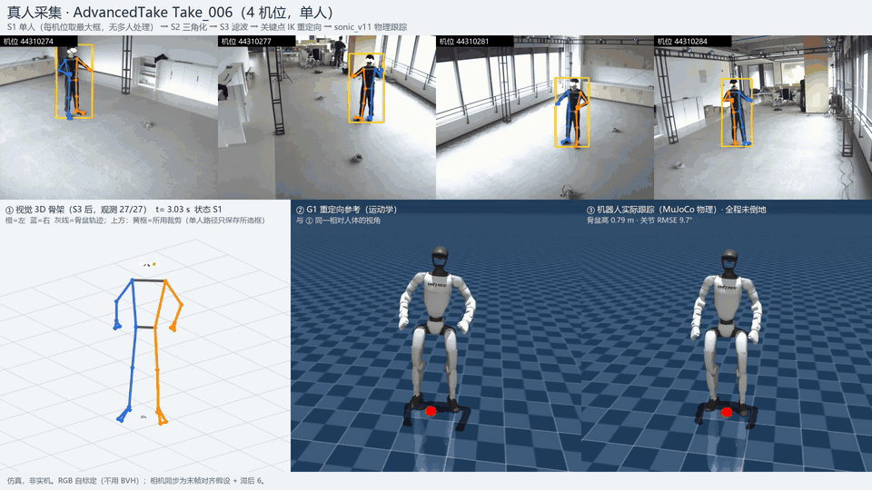
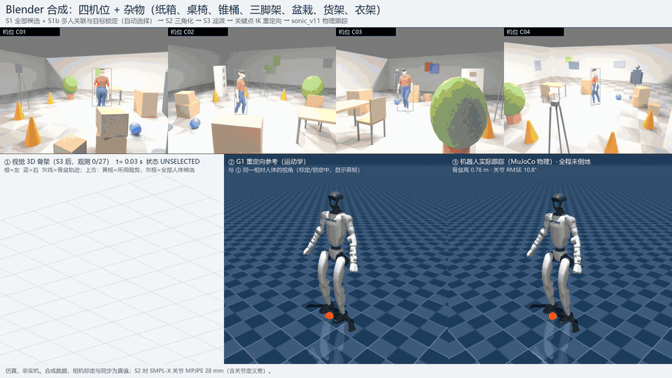

# 让机器人看懂人的全身动作

**多相机 RGB 视频 → 人体三维骨架 → 宇树 G1 人形机器人跟随。无标记、无动捕设备，全链路在物理仿真中闭环验证。**

*Markerless multi-camera RGB → 3D human pose → Unitree G1 humanoid whole-body imitation, verified in closed-loop physics simulation.*

  

<b>真人采集数据。</b>上排：四路相机同一时刻的画面与检测到的人体骨架；下排：重建的三维骨架 → 机器人的动作参考 → 物理仿真中机器人的实际跟踪。结果均来自仿真。
<a href="docs/media/demo_real.mp4">高清视频</a>

  

<b>Blender 合成场景。</b>纸箱、桌椅、锥桶、衣架等杂物之间的行走。灰框是检测器给出的全部"人"，黄框是被选中的目标；衣架在一个机位的部分帧被误判为人，多人关联模块没有选它。
<a href="docs/media/demo.mp4">高清视频</a>

## 这个项目做了什么

人在几台相机前走动、转身、摆动手臂，机器人就在仿真里做出同样的动作：

1. **看**：用普通 RGB 相机检测人体关键点，多视角几何还原三维骨架，不需要贴标记点或穿动捕服。
2. **懂**：把人的动作按身体比例换算成机器人的关节指令，逐帧计算，不需要等整段视频结束。
3. **做**：用 NVIDIA 开源的全身控制器在 MuJoCo 物理仿真中驱动 G1，让机器人保持平衡并跟随。

## 关键数字

| | |
|---|---|
| 逐帧动作重定向耗时 | 约 1–3 ms |
| 从人动到机器人动的端到端延迟 | 约 0.13–0.17 s（大部分环节已实测；相机曝光未测） |
| 10 组合成动作验收 | 10/10 通过 |
| 真人采集的 5 段动作 | 机器人 5/5 全程不倒，关节跟踪误差约 9° |
| 两人互相推搡的户外场景 | 目标人物身份稳定，骨架最大跳变从 0.60 m 降到 0.04–0.06 m |
| 自动化测试 | 64 项通过 |

## 深入阅读

- [技术概览](docs/技术概览.md)：每个模块的输入输出、参数、测试和已知限制
- [真人数据验收报告](reports/advanced-take-2026-10-27.md)：实验过程、负面结果与全部数值
- [多人遮挡专项报告](reports/mamma-multiperson-2026-10-29.md)
- [项目约定](AGENTS.md)

## 联系

邮箱：twmmuz [at] gmail [dot] com　·　GitHub：[Tw6249](https://github.com/Tw6249)

---

本仓库只含自己的代码、配置和报告，不含模型权重、数据集和第三方源码；第三方组件与数据的使用限制见[技术概览](docs/技术概览.md#第三方组件与数据)。本仓库自身的许可证尚未指定。演示中的人体为 SMPL-X 人体模型渲染（需自行从官网获取，不可再分发）。
