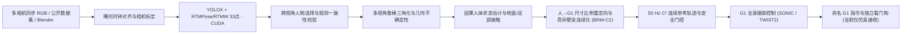

# 系统架构、数据契约与实机迁移边界

本项目实现从**多台同步无标记 RGB 相机观察人体全身动作**到**宇树 G1 EDU（29 自由度）全身模仿控制指令**的完整模块化链路。感知、几何重建、因果时序状态、全身重定向、连续参考轨迹生成与闭环跟踪控制彼此解耦，通过显式数据契约与时间戳衔接。

## 一、 核心模块与职责边界

| 阶段 | 核心模块及入口 | 关键科学/工程问题 | 当前实现与验收边界 | 实机迁移待完成项 |
|---|---|---|---|---|
| **传感器与同步** | `pose_sim/sensors.py` `scripts/import_real.py` | 跨相机时钟漂移、曝光不同步、镜头畸变 | 整数纳秒时间戳、带漂移预算的 `ClockMapping`、容差内最近未使用帧配对、内外参合法性检查 | 硬件外部触发（GPIO/PTP）、实测物理曝光到主机接收延迟 |
| **2D 检测与关键点** | `pose_sim/runtime.py` `pose_sim/inference.py` | 检测域偏移、多人干扰、手足关键点补充 | 固定权重 SHA256（YOLOX-M + RTMPose-M 身体 17 点 + RTMW-L 手足 16 点，共 33 点），强制验证 CUDA 执行 | 四路检测批处理加速、稠密手部关键点评估 |
| **跨视角选人与关联** | `pose_sim/person_selection.py` `pose_sim/multiview_temporal.py` `pose_sim/observation_consistency.py` | 多人场景目标锁定、对称肢体左右互换、单视角外点 | 跨视角极线锚点选人、留一视角重投影一致性校验、按关节对（肩/肘/腕、髋/膝/踝）关联与手足附着检验 | 全视角同时发生左右语义互换时的长期外观/时序恢复 |
| **3D 重建与不确定性** | `pose_sim/geometry.py` `pose_sim/uncertainty.py` | 低视差退化、外点抑制、误差量化 | RANSAC + 加权 DLT + 鲁棒重投影优化；正深度与最小射线夹角约束；局部 Jacobian $3\times 3$ 位置协方差 | 标定误差与曝光微偏的联合不确定性传播 |
| **因果人体状态与接触** | `pose_sim/human_state.py` `pose_sim/continuous_state.py` `pose_sim/ground.py` `pose_sim/foot_contact.py` | 遮挡短时缺测、骨长跳变、脚掌朝向与触地相位 | 因果 Kalman / 12 帧 Huber IRLS 骨长投影状态估计（最长 100 ms 显式预测）；独立自然地面拟合与因果足部接触基线 | 扩大地面纹理覆盖范围、独立接触力/落脚时刻标注验证 |
| **全身重定向与连续参考** | `motion_control/humanoid.py` `motion_control/continuous_pose_reference.py` `motion_control/reference_trajectory.py` | 人机尺寸差异、肩肘奇异区 IK 分支翻转、帧间跳变 | 按源与 G1 腿长比例映射骨盆路径；**奇异壁垒单调柔化连续重定向（BRM-C2）**消除 IK 分支跳变，输出 50 Hz $C^2$ 连续参考 | 支撑脚锚定的长距离水平防漂移、按跟踪残差自适应调度跃度上限 |
| **全身闭环跟踪控制** | `motion_control/twist.py` `motion_control/comparison_policies.py` `motion_control/humanoid_replay.py` | 自由基座动态平衡、延迟补偿、缺测安全退出 | 50 Hz 策略（SONIC v1.1 / TWIST2）+ 1000 Hz MuJoCo 物理闭环；120 ms 因果延迟下五类自然动作保持平衡并平稳停稳 | SuperMimic 等策略对比、真实 G1 关节阻尼/零位/摩擦系统辨识 |
| **指令与硬件适配** | `motion_control/g1_command.py` `motion_control/unitree.py` `motion_control/adapters.py` | 指令过期、错序、主机断连、急停 | 具名 29 关节指令（含模型 SHA256、序号、TTL、PD 增益、力矩上限）；当前严格锁死 `hardware_enabled=false` | Unitree DDS/CRC 通信、端侧独立看门狗、龙门架悬空与限速实机联调 |

---

## 二、 坐标系、单位与数据契约

- **物理单位**：长度 `m`、速度 `m/s`、角度 `rad`、角速度 `rad/s`、角加速度 `rad/s²`、角跃度 `rad/s³`、力 `N`、力矩 `N·m`、时间整数 `ns`。
- **坐标系约定（遵循 [REP-103](https://raw.githubusercontent.com/ros-infrastructure/rep/master/rep-0103.rst)）**：
  - **世界与机器人/人体局部坐标系**：右手系，`X` 向前、`Y` 向左、`Z` 向上。
  - **相机光学坐标系（OpenCV）**：`X` 向右、`Y` 向下、`Z` 向前（沿光轴）。
- **不可观测自由度保留原则**：
  - 稀疏关键点无法唯一确定前臂/小腿纯轴向自旋，以及骨盆倾斜与腰部俯仰的独立分解。
  - 不可观测或缺失、过期的自由度必须显式保留为未知或采用受控中性先验，**绝不将历史预测或仿真真值伪装成当前视觉观测**。
- **阶段解耦文件格式**：
  - 视觉感知阶段：`cameras.json` + `frames.jsonl` $\rightarrow$ `detections.jsonl` $\rightarrow$ `poses3d.jsonl` $\rightarrow$ `states3d.jsonl`。
  - 重定向与控制阶段：`states3d.jsonl` / `poses3d.jsonl` $\rightarrow$ `humanoid_reference.jsonl`（25 Hz 源参考）$\rightarrow$ 50 Hz $C^2$ 连续参考流 $\rightarrow$ `g1_commands.jsonl` 与闭环物理轨迹。

---

## 三、 实机硬件迁移前置清单

当前仓库中的所有闭环结果均来自 **MuJoCo 1000 Hz 自由基座全动力学仿真**，尚未连接物理宇树 G1。在将 `hardware_enabled` 切换为真机之前，必须逐项落实：

1. **机器人机型与关节核对**：核对实际 G1 EDU 的自由度版本（23 DoF / 29 DoF）、关节名称顺序、零位偏置、电机正方向、位置限位、额定力矩及板载 PD 增益（详见 `config/g1_twist.json` 与 `assets/unitree/`）。
2. **多相机硬同步与标定**：固定工业相机焦距、曝光时间与白平衡，接入外部硬触发信号（见 [工业相机选型与预算](camera_selection_2026-10-19.md)），完成联合内外参标定与地面平面标定，并将相机硬件曝光时间戳映射到主机单调时钟。
3. **通信、里程计与独立停止机制**：实现真实 `RobotAdapter`（Unitree SDK2 / DDS + CRC 校验），接入机器人 IMU、关节反馈与足端/里程计状态；配置板载独立超时看门狗（指令过期立即转入阻尼保护）与物理急停开关。
4. **分级上机流程**：
   - 第一步：电机失能状态下核对传感器回读、关节零位与符号一致性；
   - 第二步：龙门保护架悬空状态下验证低增益关节限速跟踪与看门狗断连急停；
   - 第三步：平地保护架下验证站立平衡、原地重心转移、慢速蹲起与踏步模仿。

---

## 四、 仓库整洁与实验诚实性约定

- **入库范围**：仅源代码（`pose_sim/`、`motion_control/`、`scripts/`）、配置文件（`config/`）、回归测试（`tests/`）、简短结构化验收报告（`reports/`）与核心文档（`docs/`）纳入 Git。
- **忽略目录**：公开数据集（`outputs/public_datasets`、`data/`）、每次实验生成的逐帧轨迹/视频（`outputs/`）、模型权重与独立 Python 运行环境保留在 `.gitignore` 忽略目录中。
- **清理工具**：实验结束后使用 `scripts/clean_outputs.py` 清理失败或被替代的中间产物（默认仅列出清单，加 `--apply` 执行删除，自动拒绝工作区外路径与重解析点/软链接）。
- **实验诚实性**：理论公式与候选模块均为待验证假设；当实测未通过验收门槛或劣于基线时，必须如实记录负面结论与失效边界（见 [reports/README.md](../reports/README.md) 与 [研究日志](research_log.md)）。
