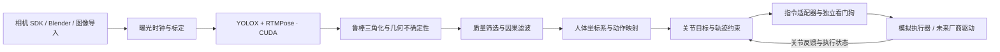

# 多视角感知到机器人指令

最新目标已明确：源可以是任意机器人，感知必须无标记，目标为宇树 G1 EDU，包含全身动作与行走。
源/目标解耦的新增实现与边界见 [源机器人到 G1](source_robot_to_g1.md)。下文保留人体 COCO17 → 通用双臂的基线说明，其人体坐标与 IK 模块并不约束其他源机器人。

下文具体描述历史人体插件：单人多视角视觉输入、三维几何、固定基座 8 自由度双臂动作映射和带反馈的运动学仿真。
新增 Panda 无标记输入及 G1 自由基座、足地接触、力矩受限动力学验证见 [源机器人到 G1](source_robot_to_g1.md)；其配置与人体插件分开。



## 模块与关键问题

| 模块及入口 | 关键科学/工程问题 | 当前方法与验收 | 尚需研究或硬件证据 |
|---|---|---|---|
| `pose_sim/sensors.py`、`scripts/import_real.py` | 不同设备时钟、曝光不同步与运动畸变 | 整数纳秒、带漂移比例/误差预算/有效期的时钟映射接口；容差内最近未使用帧；相机矩阵合法性检查 | 物理触发/PTP、曝光时刻测量；标定估计器、重标定、卷帘快门；当前映射参数由外部标定提供 |
| `pose_sim/runtime.py`、`pipeline.detect` | 检测域偏移、遮挡、跨视角身份错误 | 固定模型 SHA256、实际 CUDA 会话、单人检测门限；多人的视角拒绝 | 各视角各自只有一个人仍不保证同一身份；需控制单人采集区域，或增加跨视角关联与数据集验证 |
| `pose_sim/geometry.py`、`uncertainty.py` | 外点、低视差、深度病态、误差量化 | RANSAC、加权 DLT、鲁棒重投影；正深度/夹角筛选；局部 Jacobian 协方差；理想投影/畸变/外点/距离退化测试 | 标定误差和时间偏差的联合传播；相关检测误差；人体真实关键点真值 |
| `motion_control/pose.py` | 抖动与延迟权衡、错误骨长、缺失与假连续 | 因果 One Euro 滤波；质量、骨长、跳变门限；缺失立即撤回当前目标；静止噪声与因果性回归 | 阈值需按相机、人群和动作速度调参；长期遮挡重识别；未宣称滤波改善真实 MPJPE |
| `motion_control/retarget.py`、`model.py` | 人机尺寸/自由度不一致、IK 多解、旋转不可观测 | 躯干局部坐标；上臂/前臂单位方向匹配；有界最小二乘和连续性正则；刚体变换不变性、FK/IK 回归 | COCO17 无法唯一观测肢体轴向扭转、腕姿与手指；机械臂末端任务需新的映射器；全身机器人需平衡、接触与动力学约束 |
| `motion_control/controller.py` | 观测低频、控制高频、延迟、追踪偏差与故障 | 独立 50 Hz 虚拟控制时钟；位置/速度/离散加速度限制、制动距离约束；恢复需连续有效帧；反馈错误/急停锁存 | 此 Python 回放不是实机硬实时控制器；连续轨迹插值、jerk、碰撞、力矩和负载约束未覆盖 |
| `motion_control/adapters.py` | 指令重复、过期、关节错序、主机失联 | 模型哈希、序号、有效期、单位、关节顺序与限位验证；独立指令看门狗；运动学伺服反馈；ROS 2 消息布局导出 | 真实驱动、ACK、设备时钟映射与端侧看门狗；独立急停和具体机器人安全功能 |
| `motion_control/replay.py`、`preview.py` | 可重复评估与指标混淆 | 不读取 GT；保存观察、目标、命令、反馈、故障、模型和输入哈希；指令约束检查、静止结束和动作生成断言 | 注入 120 ms 延迟不等于实测曝光到执行延迟；模拟反馈误差不等于实机误差 |

这些方法为每个问题建立可测量的基线与明确失败行为；尚未解决的问题不能用示例通过代替。核心优先级是先降低错误动作风险，再提高覆盖率和动作流畅度。

## 数据约定与可替换边界

- 长度 m、角度 rad、速度 rad/s、加速度 rad/s²、时间整数 ns。机器人/人体局部轴为 X 前、Y 左、Z 上，右手系；相机光学轴 X 右、Y 下、Z 前。这与 [REP-103](https://raw.githubusercontent.com/ros-infrastructure/rep/master/rep-0103.rst)一致。
- 感知阶段沿用 `frames.jsonl → detections.jsonl → poses3d.jsonl`，与机器人模块通过文件/记录接口解耦。`poses3d` 的名称顺序显式给出；控制按名称取点，不假定数组索引。
- 新增 `quality.position_covariance_m2`、`linearized_max_std_m`、`assumed_pixel_sigma`。假设各内点像素独立、各向同性且标准差 2 px，以 `Σ = σ² (JᵀJ)⁻¹` 计算。数值仅表示局部几何条件；不能把它当作含标定误差的真实置信区间。
- 控制要求双肩、双肘、双腕、双髋共 8 点有效；最大线性化标准差默认 0.05 m。旧姿态文件缺少该字段时需要先重新运行 reconstruct，不能静默跳过质量要求。
- `BodyObservation` 输出躯干原点、旋转矩阵和双臂方向。它不估计完整人体关节旋转。上臂与前臂方向消除人体骨长与机器人连杆长度的差异；机器人方向由其自身 FK 计算。
- IK 目标为 `Σ ||d_robot(q) − d_human||² + λ||q − q_previous||²`，带各关节上下界。残差过大/求解失败撤回目标。冗余关节的角度由连续性正则选择，不宣称恢复不可观测的真实人体扭转。
- 模型 JSON 包含轴、连杆、关节顺序、限位和控制配置。当前 `ArmRetargeter` 约定左右两条独立手臂链；机械臂任务、共享躯干链或全身模型应新增映射器/运动学实现，复用 `JointTarget` 和控制/适配接口。
- `RobotAdapter` 只负责反馈、发送和停止。物理实现应完成电机单位转换及设备确认，不能把模型中的示例参数当作设备参数。

`JointCommand` 包含 `schema_version`、递增 `sequence`、产生时间、`valid_until_ns`、来源曝光时间、`clock_domain`、`robot_id`、`model_sha256`、`joint_names`、位置、速度与状态。来源缺失时不伪造新曝光时间。`replay_monotonic` 的时间只在本次回放内有意义，不能直接当作墙上时钟或机器人开机时间。

控制状态：连续有效观察后进入 TRACKING；观察拒绝/过期时 BRAKING，速度为零后 HOLD。反馈失效、设备禁用、跟踪偏差、时间跳变或急停触发锁存停止并调用适配器 `stop`，不会自动恢复。未知设备状态时不宣称主机仍能可靠制动。模拟器的停止是理想化动作，真实停止依赖设备功能。

控制器按实际调用间隔积分，支持小幅调度抖动；默认单次间隔超过 40 ms 或时间倒退触发停止。首条指令必须对应静止反馈。固定 50 Hz 是回放配置，不要求物理时钟恰好逐纳秒对齐；这些时间预算仍须在具体硬件上重新测量。

## 硬件接入前需要落实的内容

1. **机器人模型与任务**：型号、URDF/连杆与关节定义、位置/速度/力矩控制模式、真实限位、负载和末端工具。完成零位、符号、比例与编码器回读校验。若任务是末端定位而不是人体模仿，改用经过世界到机器人基座标定的任务空间映射。
2. **相机与标定**：固定焦距/分辨率、共同外参、设备曝光时间、时钟偏差/漂移与映射误差预算。当前 `FrameSource` / `ExposureFrame` / `ClockMapping` 为 SDK 接入契约；没有虚构相机驱动或已完成标定。
3. **执行链路**：实现 `RobotAdapter`，将设备反馈映射到共同单调时钟；拒绝过期/重复指令；端侧独立看门狗、ACK、断网停止和急停。当前模拟器与导出器均不会打开网络或发送到物理设备。
4. **规划与动力学**：使用实际几何验证自碰撞、障碍物、可达性；依真实控制器插值重新定时，验证连续速度、加速度、jerk、力矩与负载。人形机器人还需要支撑多边形、质心/动量与足地接触控制。当前关节限幅不替代这些模块。
5. **分级验收**：合成数据与故障注入 → 实采录像离线重放 → 与真实 URDF/驱动相同接口的动力学仿真 → 电机禁用的指令/反馈检查 → 限速、限定工作区的实机试验。记录每级的曝光到指令 P50/P95/P99、丢帧、停止延迟、轨迹误差和碰撞/限位事件。

ROS 2 导出遵循 [Joint Trajectory Controller](https://control.ros.org/jazzy/doc/ros2_controllers/joint_trajectory_controller/doc/userdoc.html)的具名关节、位置与到达时间结构。`ros2_trajectory.json` 包含 `simulation_only` 包装和 `message` 消息体；当前导出位置折线，离散加速度检查不能约束接收端插值的连续加速度。实机驱动接入后应选择有执行反馈的动作接口，并结合设备重新定时、验证和取消行为。没有安装 ROS 2，也没有把 JSON 序列化当作 ROS 网络联调成功。

One Euro 的速度自适应截止频率按[作者算法及调参说明](https://gery.casiez.net/1euro/)实现。当前参数用于米制位置；需用实际数据单独评估静态抖动与动态滞后。

## 保持项目干净

`AGENTS.md` 持久记录上述模块化、验证和清理约定。可入库内容仅为源代码、配置、测试和简短报告；生成数据、模型与运行时保持忽略。

当前保留 `outputs/gpu_session02` 及 `benchmark03` 作为先前 GPU 同图像基准证据，以及 `outputs/robot_demo` 作为完整控制链路基线。失败或被替代的实验由 `scripts/clean_outputs.py` 清理；默认仅列出，`--apply` 执行。工具拒绝 outputs 根目录、外部路径以及符号链接/重解析点。不按时间或模糊文件名自动删除未知数据。

```powershell
$rt = Get-Content .runtime.json -Raw | ConvertFrom-Json
& $rt.python scripts/clean_outputs.py outputs/failed_experiment
& $rt.python scripts/clean_outputs.py outputs/failed_experiment --apply
```

每次实验结束只保留当前基线及必要对照；先保存短报告再清理不再使用的产物。运行环境和正在使用的模型不是废弃实验，不能为了目录数量少而删除。
