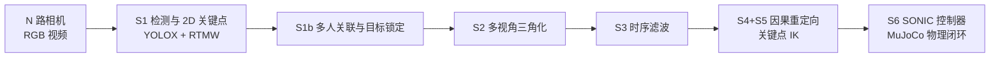

# 技术概览：多视角 RGB → 宇树 G1 全身动作模仿

返回[项目主页](../README.md)。以下为模块、参数、测试与已知限制的详细说明。

**Markerless multi-view RGB whole-body motion imitation for the Unitree G1 humanoid — perception, retargeting and closed-loop physics simulation.**

多台相机拍摄的无标记 RGB 视频，经 2D 关键点检测、多视角三角化和因果重定向，驱动宇树 G1 在 MuJoCo 中由 SONIC 控制器闭环跟踪。每个模块都有明确的输入输出、单位、坐标系和失败行为，并由测试和验收报告覆盖。

> **状态（2026-10-29）**：全部结果来自仿真，**没有实机验证**。动捕 BVH 只用于离线评分，不是任何模块的输入。项目约定见 [AGENTS.md](../AGENTS.md)，原始技术规范见 [docs/方案规范.md](方案规范.md)。

## 链路



| 模块 | 文件 | 输入 → 输出 | 说明 |
|---|---|---|---|
| S1 | [s1_vision_tracker.py](../g1_imitation/core/s1_vision_tracker.py) | 各相机图像 → 每路 27 个 2D 关键点 | 每帧 YOLOX 检测 + RTMW（COCO‑WholeBody 133 点取 27 点），GPU ONNX |
| S1b | [s1b_person_association.py](../g1_imitation/core/s1b_person_association.py) | 全部候选人的 2D 关键点 → 目标人物的 2D 关键点 | 多人场景：跨视角分组、3D 轨迹、目标锁定；歧义、遮挡或丢失时输出无效，不会换人 |
| S2 | [s2_triangulation.py](../g1_imitation/core/s2_triangulation.py) | 多路 2D → 27 个 3D 点（米，Z 朝上） | 加权 DLT，留一/留二相机共识剔除离群点 |
| S3 | [s3_temporal_filter.py](../g1_imitation/core/s3_temporal_filter.py) | 3D 轨迹 → 平滑轨迹 | 因果 One‑Euro + 地面约束；典型滞后约 67 ms |
| S4+S5 | [s45c_keypoint_ik.py](../g1_imitation/core/s45c_keypoint_ik.py) | 27 个 3D 点 → G1 参考 `q(36)`、`dq(35)` | **默认**：逐帧因果，肢体方向迁移 + 热启动 Mink IK，单线程每帧约 1.3 ms |
| S4+S5 参照 | [s45_gmr_retarget.py](../g1_imitation/core/s45_gmr_retarget.py) | 27 点 → SMPL‑X 拟合 → GMR | **仅离线对照**：整段拟合，需要未来帧，不能实时 |
| S6 | [s6_mujoco_closed_loop.py](../g1_imitation/core/s6_mujoco_closed_loop.py) | G1 参考 → 物理仿真 | 官方 G1 模型（scene_43dof）；SONIC v1.1 / low_latency；6A 运动学回放、6B 物理闭环 |

重定向的假设（不是测量值）：
- 骨盆前倾 = `pelvis_trunk_share`（0.5）× 躯干倾角，因为两个髋点测不出骨盆俯仰。
- 手臂或腿伸直时的扭转测不出来，由弱姿态项拉回默认姿态。
- 手的朝向不跟踪：掌指关节点噪声会翻转手的坐标系，而且没有真值可以验证。
- 缺失数据保持上一帧，不外推。

所有参数在 [pipeline_config.json](../g1_imitation/config/pipeline_config.json)，每个参数块里都写了来源和取值理由。

## 当前结果

### 单人（AdvancedTake 真人数据与合成动作）

| 项目 | 结果 |
|---|---|
| 10 组合成动作 S6 验收（存活 / 关节 RMSE / 支撑脚滑移） | 10/10；0.065–0.100 rad（< 0.12）；0.001–0.020 m/s（< 0.04），全部通过 |
| 真人 5 段，S3 滤波输入，SONIC low_latency，不加延迟 | 5/5 存活；RMSE 0.159 rad；终点偏差 0.29 m |
| 与动捕的肢体方向误差（物理仿真后，手臂 / 腿） | 关键点 IK：滤波输入 17.0° / 11.7°，不滤波 15.0° / 10.8°；离线 SMPL‑X + GMR 17.4° / 10.5° |
| 延迟（已测部分） | S3 约 67 ms + 30→50 Hz 保持约 17 ms + 姿态网络约 6 ms + 重定向约 1 ms + 机器人响应 40–80 ms ≈ 130–170 ms；相机曝光和传输未测 |

### 多人与遮挡（MAMMA 户外四机位，2 人互相推搡，120 帧，无 3D 标注）

S1 原本每个机位独立选框，机位之间没有身份约束。在这段数据上，现有链路在第 93 帧悄悄换了人，出现过 0.60 m 的躯干跳变和 63% 的骨长波动。加入 S1b 后：

| | 现有链路 | S1b 锁定站立者 | S1b 锁定倒地者 |
|---|---|---|---|
| 目标身份 | 第 93 帧换人 | 118/120 帧稳定跟踪 | 118/120 帧稳定跟踪 |
| 躯干逐帧最大位移 | 0.60 m | 0.042 m | 0.063 m |
| 骨长变异系数最大值 | 62.7% | 8.3% | 18.9% |
| 仿真闭环 | 倒地 | 未倒地 | 随目标倒地 |

在单人数据（AdvancedTake 5 段）上插入 S1b 后，3D 输出与原链路几乎逐帧相同，S1b 的额外延迟中位约 12 ms。这些是一致性检查，不是精度：该片段没有 3D 标注。完整数据与负面结果见 [reports/mamma-multiperson-2026-10-29.md](../reports/mamma-multiperson-2026-10-29.md)。

### 测试

`pytest tests`：64 项通过，3 项 strict XFAIL。这 3 项是 S1/S2/S3 规范原文的字面参数被证伪后保留的对照项，阈值没有改动。

## 已知限制

- 真人数据只有 5 段单人加 1 段 4 秒双人片段；仅仿真，没有实机验证。
- 多人场景必须由操作者指定目标；自动选择只适用于工作区内只有一个人的情况。S1b 只解决"跟谁"，不判断"该不该模仿"：目标倒地时机器人照样倒地，还没有动作域检查。
- 目标被挡到只剩两个相对的机位时，几何条件很差，但状态仍标为正常跟踪。
- 合成行走时机器人原地跟踪，不会向前走；真人行走片段能跟着走。
- S3 滤波的滞后是最大的延迟来源，也让腿部误差多出 1–2°。
- 参考轨迹不经过速度/加速度限制就送给 SONIC；数据长时间缺失时只会保持上一帧。上实机前必须补上轨迹约束和超时停止。
- low_latency 控制器在不加延迟时看到的是静止的参考窗口，这不在它的训练分布内，上实机前要单独验证。

完整的实验过程、负面结果和全部数值见 [reports/advanced-take-2026-10-27.md](../reports/advanced-take-2026-10-27.md)。

## 仓库结构

```text
g1_imitation/            代码包
  core/                  S1–S6 模块、BVH 读取（bvh.py，只用于评分）、评测工具（adv_eval.py）
  config/                pipeline_config.json：参数、模型哈希、运行环境路径
  gmr_bridge/            GMR 离线参照：在独立的 GMR 环境中运行的子进程
scripts/                 实验、评测与渲染脚本
tests/                   单元测试与验收测试
docs/                    方案规范、硬件与相机选型；docs/vendor/ 放厂商手册（不入库）
reports/                 验收报告（实验过程与全部数值）
requirements-lock.txt    主运行环境的依赖锁定；requirements-gmr-lock.txt 是 GMR 环境的
data/      （不入库）     原始视频、动捕、公开数据集
outputs/   （不入库）     生成结果与演示视频
```

## 运行

运行环境是固定的本地虚拟环境，路径见 `pipeline_config.json` 的 `runtime.python`；GMR 环境见 `s45_gmr_retarget.python`。重定向的 IK 矩阵很小，多线程 BLAS 反而更慢，实时进程要设置 `OPENBLAS_NUM_THREADS=1`（评测脚本已经自动设置）。需要 NVIDIA GPU（ONNX Runtime CUDA）；Blender 合成场景另需 Blender 4.5 和 OptiX。

```powershell
$py = "<pipeline_config.json 中 runtime.python 的路径>"
& $py -m pytest tests -q                                   # 全量测试，约 5 分钟
& $py scripts/s6_keypoint_ik_eval.py                       # 默认重定向 + SONIC：合成 13 组与 AdvancedTake 5 段
& $py scripts/advanced_take_limb_direction_eval.py         # 与动捕的肢体方向误差（离线评分）
& $py scripts/mamma_multiperson_eval.py                    # 多人场景：S1b 与现有链路对照
& $py scripts/advanced_take_s1b_regression.py              # 单人回归：S1b 是否改变已验收的结果
& $py scripts/render_showcase_videos.py                    # 演示视频：四路原画 + 2D 骨架 + 重定向参考 + 物理跟踪
```

演示视频由数据集和仿真现场生成，放在被忽略的 `outputs/showcase_videos/`。仓库只发布两段（[media/](media/)）：自采真人数据 AdvancedTake Take_006 的 3.0–10.5 s，和 Blender 合成场景；MAMMA、MPI-INF-3DHP 等第三方数据集的许可不允许再分发，相关视频不发布。

AdvancedTake 真人数据的处理顺序：`advanced_take_audit` → `advanced_take_s1_extract` → `advanced_take_calibrate` → `advanced_take_rgb_register` → `advanced_take_s2s3_eval` → `s6_keypoint_ik_eval`。

## 第三方组件与数据

本仓库只含自己的代码、配置和报告，不含模型权重、数据集和第三方源码。各组件按各自许可使用，细节以上游仓库为准：

| 组件 | 用途 | 备注 |
|---|---|---|
| RTMW / rtmlib、YOLOX | 2D 检测与关键点 | 权重由 rtmlib 缓存下载 |
| MuJoCo、Mink | 物理仿真、IK | |
| SONIC（NVlabs GR00T-WholeBodyControl） | G1 全身控制器 | ONNX 权重不入库，`pipeline_config.json` 记录哈希 |
| GMR（MIT） | 离线重定向参照 | |
| EasyMocap | 离线 SMPL‑X 拟合 | Project Registration License：研究与评测可用，机构项目使用需注册 |
| SMPL‑X 人体模型 | 离线拟合与 Blender 合成人体 | 需自行从官网获取，不可再分发 |
| MAMMA 公开示例 | 多人遮挡测试 | 仅限非商业本地研究，不可再分发 |
| MPI‑INF‑3DHP | 公开数据测试 | 研究用途，请遵守原数据集许可 |

本仓库自身的许可证尚未指定。
