# 海康工业相机自建方案：前期问题剖析与工程执行手册

> **文档状态与边界声明（2026-10-29）**  
> 本手册面向本项目**方案一（海康 `MV-CS020-10GC` 全局快门工业相机自建方案）**从“离线仿真验证”迈向“物理采集与宇树 G1 EDU 真机闭环”的前期准备。  
> 遵循 [`AGENTS.md`](AGENTS.md) 规范：当前仓库中的模块 `S1–S6` 仅在仿真与离线数据集上完成验证，**尚未经过任何物理相机在线采集或真实机器人闭环测试**。本手册明确区分“已验证算法模块”、“现有代码中的仿真假设”与“待开发的实物工程模块（`R1–R4`）”，所有新增或改造模块均严格定义输入、输出、单位、坐标系、时间基准、失败行为及量化验收标准。

---

## 零、 核心硬件设备实物图鉴与接口速查

为避免纯文字与抽象框图带来的理解偏差，以下列出本套自建硬件方案所涉及的 **6 类核心物理设备实物照片、型号规格、物理接口形态与关键设定**：

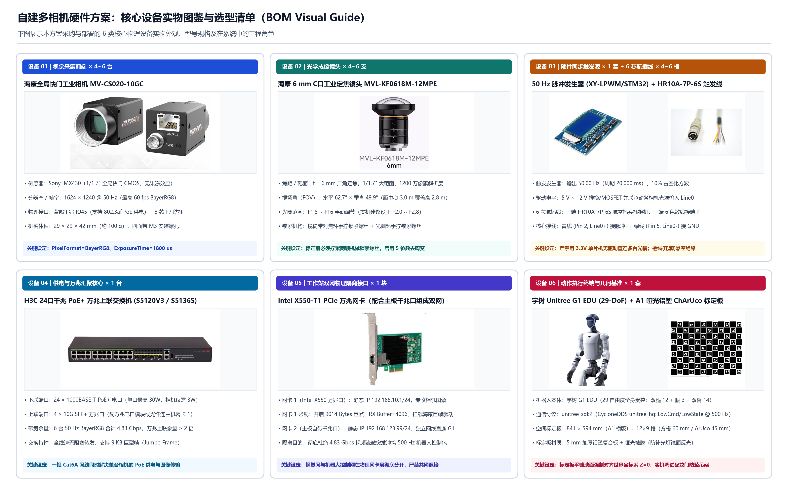
*▲ 设备图鉴 1：本方案采购与部署的 6 类核心物理设备实物外观、型号规格及在系统中的工程角色总览。*

| 设备编号 | 设备名称与具体型号 | 数量 | 物理接口与外观特征 | 系统内承担角色与必配参数 |
|---|---|---|---|---|
| **设备 01** | 海康全局快门工业相机<br>`MV-CS020-10GC` | 4–6 台 | 正面 C-Mount 螺纹接口（内嵌 $1/1.7''$ IMX430 靶面）；背面千兆 RJ45 网口（`LAN/POE`）+ 6 芯 P7 航插公座（`PWR`）；机身 $29\times 29\times 42\text{ mm}$ 四面带 M3 螺孔 | 采集 $1624\times 1240$ @ $50\text{ Hz}$ 同步图像；必设 `PixelFormat=BayerRG8`、固定曝光 `1800 us`、`TriggerSource=Line0` |
| **设备 02** | 海康 6 mm C 口工业定焦镜头<br>`MVL-KF0618M-12MPE` | 4–6 支 | $1/1.7''$ 靶面、1200 万像素级解析度；镜筒带**对焦环手拧锁紧螺丝**与**光圈环手拧锁紧螺丝** | 提供 $62.7^\circ \times 49.9^\circ$ 广角视场；标定前光圈调至 `F2.0~F2.8`、合焦后**必须拧死两颗锁紧螺丝** |
| **设备 03** | 50 Hz 硬件脉冲发生器 + 6 芯触发线<br>`XY-LPWM` / STM32 + `HR10A-7P-6S` | 1 套 + 4–6 根 | 触发器带 LCD 频率/占空比数显与 `PWM/GND` 螺钉端子；航插线一端为 6 孔金属插头，另一端为 6 色散线 | 输出 $50.00\text{ Hz}$、$10\%$ 占空比（$2\text{ ms}$ 脉宽）、$5\text{–}12\text{ V}$ 方波；接航插线**黄色线（`Pin 2: Line0+`）**与**绿色线（`Pin 5: Line0-`）** |
| **设备 04** | 24 口千兆 PoE+ 万兆上联交换机<br>`H3C S5120V3-28P` / `S5136S-24P` | 1 台 | 前面板 24 个千兆 RJ45 PoE+ 电口 + 4 个 `10G SFP+` 万兆上联插槽 | 1~6 号千兆电口通过单根 Cat6A 网线同时为相机 PoE 供电与收图；万兆口汇聚 $4.83\text{ Gbps}$ 流量上联工作站 |
| **设备 05** | PCIe 万兆以太网卡（配合主板千兆口）<br>`Intel X550-T1` (10GbE) | 1 块 | PCIe x4/x8 插卡，单口 10GBASE-T RJ45 万兆电口，带黑色散热片 | **网卡 1（X550 万兆）**配 `192.168.10.1/24` 专收相机流（开 $9014\text{ B}$ 巨帧）；**网卡 2（主板千兆）**配 `192.168.123.99/24` 直连机器人 |
| **设备 06** | 宇树人形机器人 + A1 标定板 + 龙门架<br>`Unitree G1 EDU` (29-DoF) | 1 套 | 29 自由度机身（双腿 12 + 腰 3 + 双臂 14）；配套 $841\times 594\text{ mm}$ A1 哑光铝塑 ChArUco 标定板与龙门防坠吊架 | 通过 `unitree_sdk2` (`unitree_hg`) 以 $500\text{ Hz}$ 收发 `LowCmd/LowState`；标定板平铺地板强制对齐世界坐标系 $Z=0$ |

---

## 一、 核心差距总览：从离线仿真到自建硬件真机闭环的 10 个技术断层

当前代码库（[`g1_imitation/core/`](g1_imitation/core/)）的数据流建立在“本地已解码视频文件 + 理想针孔相机模型 + 固定采样率假设 + MuJoCo 进程内同步调用”之上。若直接接入自建多相机硬件与宇树 G1 真机，将在物理层、几何层、时序层和控制安全层遇到以下 **10 个确定性工程断层**：

| 编号 | 所属层级 | 现有仿真管线现状 / 隐含假设 | 接入自建硬件后的物理现实与失效机理 | 对应改造或新增模块 | 验收红线指标 |
|---|---|---|---|---|---|
| **G01** | 物理触发层 | 假设多路视频帧天然在同一时刻采样 | 海康相机 `Line0` 为光耦隔离输入，STM32 3.3V GPIO 直接并联 4–6 台会导致驱动电流不足、边沿迟缓甚至无法触发 | 硬件同步触发分配器 + **模块 R1** | 多机曝光时差 $< 1.0\text{ ms}$（目标 $< 0.1\text{ ms}$） |
| **G02** | 网络传输层 | 从本地磁盘读取已压缩的 MP4 文件 | 6 台 50 Hz 原始图像同时曝光后在同一微秒向交换机突发灌包（Micro-burst），若传 `RGB8` 或未设错峰发包，必然引发交换机缓存溢出丢帧 | **模块 R1**（`BayerRG8` + 巨帧 + `GevSCPD` 错峰） | 连续采集 30 分钟丢帧率 $= 0.0\%$ |
| **G03** | 光学几何层 | `S1`/`S2` 仅接收 $3\times 4$ 线性投影矩阵 $\mathbf{P}_c$，假设镜头**零畸变** | 6 mm 广角定焦镜头（水平视场 $62.7^\circ$）边缘存在显著径向/切向桶形畸变，导致人走到活动区边缘时多视角射线无法交汇，触发 `S2` $15\text{ px}$ 门控误剔除支撑脚 | **模块 R2** + `S1`/`S2` 稀疏 2D 去畸变改造 | 全场标定重投影误差 $< 0.8\text{ px}$ |
| **G04** | 空间基准层 | `pipeline_config.json` 用 `pelvis_height_prior_m = 0.92` 估计尺度与地面 | 真实操作员身高各异，先验假设会导致步幅缩放失真、脚底悬空或穿透物理地板，引发 `S6` 控制器步态失稳 | **模块 R2**（ChArUco 标定 + 地面 $Z=0$ 刚体对齐） | 场地中心与四角地面角点 $|Z| < 3.0\text{ mm}$ |
| **G05** | 视觉吞吐层 | `S1b` 对每路图像逐框串行运行 YOLOX 与单样本 RTMW，四路回放仅 **11.46 Hz** | 无法匹配相机 50 Hz 硬件触发与 SONIC 控制器 50 Hz（$\Delta t = 20\text{ ms}$）控制周期，造成帧积压与端到端延迟发散 | `S1`/`S1b` 批量推理与 `TRACK_MODE` 切图调度改造 | 4–6 路单步视觉提取总耗时 $< 12.0\text{ ms}$ |
| **G06** | 时序滤波层 | `S2`/`S3` 默认采样率硬编码为 `100.0 Hz` | 海康 `MV-CS020-10GC` 全幅最高 60 Hz（工作频率设为 50 Hz），采样率参数失配会导致 One-Euro 滤波截止频率计算偏差及帧间位移门控失准 | `S2`/`S3` 真实硬件时间戳 $\Delta t_k$ 驱动改造 | 严格按相机硬件曝光时间差 $\Delta t_{\text{dev}}$ 更新 |
| **G07** | 轨迹约束层 | `S45c` 解出的关节角 $\mathbf{q}_{\text{ref}}$ 未经速度/加速度限幅直接送入控制器 | 遮挡恢复瞬间或单帧 IK 分支跳变会产生超大关节角速度指令，在真机高刚度 PD 下激发剧烈机械冲击 | 新增**因果轨迹约束器（Trajectory Limiter）** | 单步关节参考跳变 $\max|\Delta \mathbf{q}_{\text{ref}}| \le 0.35\text{ rad}$ |
| **G08** | 动作域安全层 | `S1b` 只锁定目标身份，不判断动作是否可执行（目标倒地时机器人随之倒地） | 真人发生跌倒、坐地、大幅度弯腰越界或走出工作区时，若原样映射给真机，将直接导致宇树 G1 倾覆损坏 | 新增**动作域安全包络门控（Envelope Gate）** | 骨盆高度或倾角越界时立即拒绝跟随并保持安全站姿 |
| **G09** | 控制器预览层 | `sonic_low_latency` 在不加人工延迟时接收重复的当前帧（零未来预览） | 零预览窗口不在该策略原始训练分布（`0..180 ms` 未来窗口）内，真机极限动态动作下存在未知稳定性边界 | `S6` / **模块 R3** 实机前专项边界验证 | 在吊架与地面保护下完成零预览 vs 短预览对照测试 |
| **G10** | 进程与通信层 | 视觉、IK 与 MuJoCo 仿真在同一 Python 进程内串行执行 | Python GIL、GC 停顿与 GPU 同步会引起数十毫秒抖动，直接破坏真机 DDS 实时通信周期，且缺少啮合缓冲与超时熔断 | **模块 R3**（双进程共享内存）+ **模块 R4**（安全护栏） | 控制进程周期偏差 $< 0.2\text{ ms}$，P99.9 抖动 $< 2.0\text{ ms}$ |

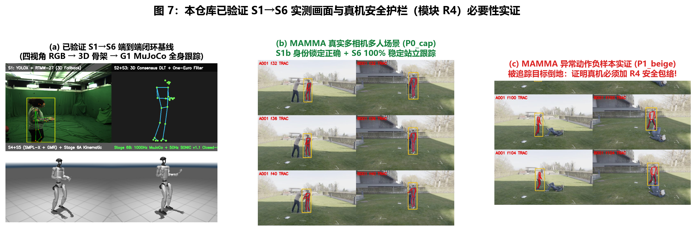
*▲ 图 7：本仓库现有离线验证基线（左：四视角 RGB 到 G1 全身闭环；中：MAMMA 多人场景 `P0_cap` 100% 稳定跟踪；右：MAMMA `P1_beige` 中被追踪真人倒地导致无 `R4` 安全包络的机器人跟随倾覆，直观证明实机部署必须补齐 `R1–R4` 硬件与安全工程层）。*

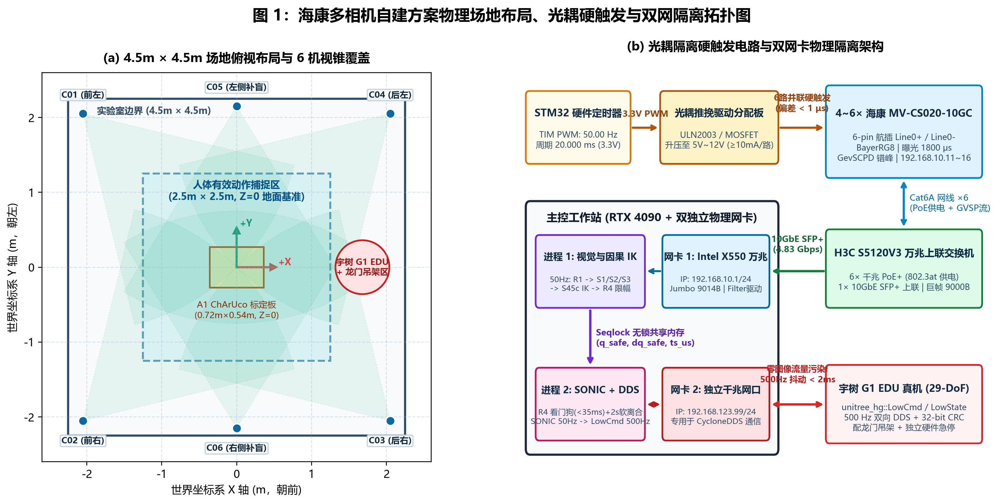
*▲ 图 1：海康 `MV-CS020-10GC` 多相机自建方案物理场地俯视布局（左：$4.5\text{ m}\times 4.5\text{ m}$ 场地与 $2.5\text{ m}\times 2.5\text{ m}$ 捕捉区）及光耦硬触发分配、双网卡物理隔离拓扑（右）。*

---

## 二、 前期核心问题深度剖析

### 2.1 物理采集与网络传输层：为什么不能“插上网线直接采”？

#### （1）光耦隔离硬触发的电气特性
海康 `MV-CS020-10GC` 的 6 芯 P1 航插接口中，外部触发输入 `Line0+` 与 `Line0-` 内部串联了限流电阻与光电耦合器发光二极管（典型导通压降约 $1.2\text{–}1.4\text{ V}$，可靠导通电流需 $5\text{–}10\text{ mA}$，推荐外部驱动电压为 **$5\text{ V}\text{–}12\text{ V}$**）。
- **错误做法**：将 STM32 开发板的单个 $3.3\text{ V}$ GPIO 引脚直接用导线一分四/一分六并联接到多台相机的 `Line0+`。这不仅接近 $3.3\text{ V}$ 光耦导通电压下限，而且多路并联电流会拉低引脚电平，引起各相机光耦导通时刻漂移甚至漏触发。
- **正确做法**：STM32 定时器（TIM PWM 模式）输出 $50\text{ Hz}$ 基准方波，经过一级 **MOSFET 或推挽驱动芯片（如 `ULN2003` / `74HC245` + 5V/12V 供电）** 进行多路隔离放大后，再并联驱动 4–6 台相机的 `Line0` 光耦输入。

#### （2）曝光同步（Exposure Sync）$\neq$ 帧到达同步（Arrival Sync）
- **物理机理**：当 $N$ 台相机在同一微秒收到硬件上升沿脉冲并完成 $1.5\text{–}2.0\text{ ms}$ 曝光后，所有相机的网卡芯片会**在同一时刻**开始向 H3C 交换机发送 UDP 图像数据包（GVSP 协议）。
- **带宽与突发算术**：
  - 单帧分辨率 $1624 \times 1240 = 2,013,760\text{ Byte} \approx 2.01\text{ MB}$（按 `BayerRG8` 单通道 8-bit 计）。
  - 若错误地在相机内开启 `RGB8` 传输，单帧体积变为 $6.04\text{ MB}$，50 Hz 下单机带宽达 $2.42\text{ Gbps}$，直接超出相机自身的 1 Gbps GigE 物理网口上限，帧率会被硬件强制腰斩至 $< 20\text{ Hz}$。
  - 在正确的 `BayerRG8` 模式下，6 台 50 Hz 平均总吞吐量为 $4.83\text{ Gbps}$（4 台为 $3.22\text{ Gbps}$）。虽然小于交换机到主机的 $10\text{ Gbps}$ 上联带宽，但如果 6 台相机同时全速发包，瞬时峰值速率仍会冲击交换机端口缓存。
- **工程对策**：必须在相机端保持**同时曝光**（保证三维几何无运动时差），但在网络层通过 GigE Vision 的 **`GevSCPD`（Stream Channel Packet Delay，包间延迟）** 参数配置错峰发包，并在网卡端开启 **$9000\text{ Byte}$ 巨帧（Jumbo Packet）** 将每帧拆包数量从约 1400 个减少至约 250 个，彻底消除交换机丢包。

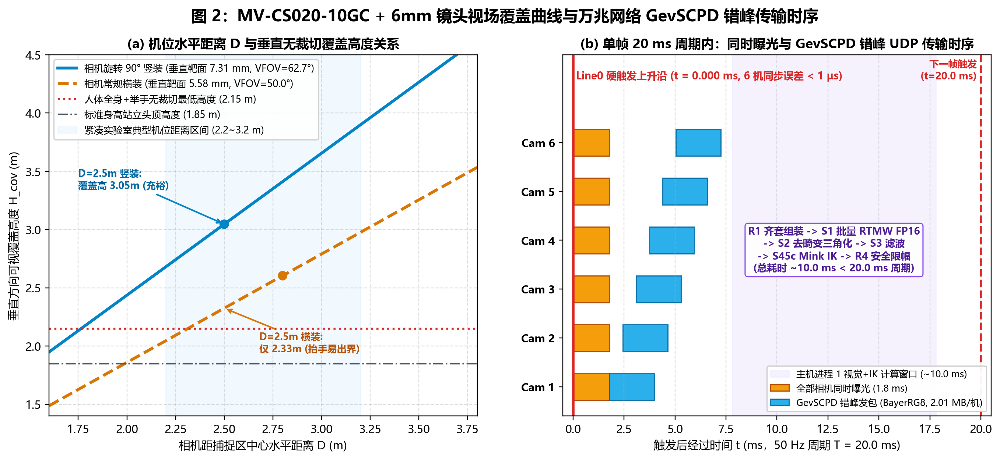
*▲ 图 2：（a）`MV-CS020-10GC` 搭配 6 mm 镜头在常规横装与旋转 $90^\circ$ 竖装下的机位距离-垂直覆盖高度定量关系；（b）单帧 $20.0\text{ ms}$（$50\text{ Hz}$）周期内 6 台相机同时 $1.8\text{ ms}$ 曝光与 `GevSCPD` 错峰 UDP 传输、主机 GPU 批量推理时序图。*

---

### 2.2 光学几何与空间标定层：为什么现有代码中的两个假设必须替换？

#### （1）零畸变针孔假设的失效（代码位置：`s1_vision_tracker.py`、`s2_triangulation.py`）
检查 [`g1_imitation/core/s2_triangulation.py`](g1_imitation/core/s2_triangulation.py) 可知，当前三角测量直接求解线性方程组：
$$w_c \left( u_c \mathbf{P}_{c,3}^\top - \mathbf{P}_{c,1}^\top \right) \tilde{\mathbf{X}} = 0, \quad w_c \left( v_c \mathbf{P}_{c,3}^\top - \mathbf{P}_{c,2}^\top \right) \tilde{\mathbf{X}} = 0$$
其中 $\mathbf{P}_c = \mathbf{K}_c [\mathbf{R}_c \mid \mathbf{t}_c]$。该公式仅在理想线性针孔相机下成立。  
而自建方案选用的 6 mm 镜头（`MVL-KF0618M-12MPE`）在 $1/1.7''$ 传感器四角具有不可忽略的径向畸变（$k_1, k_2, k_3$）。当操作员走到 $2.5\text{ m}\times 2.5\text{ m}$ 捕捉区边缘或抬手接近画面边界时，脚踝和手腕的真实像素位置相比理想线性投影会偏移 **$8\text{–}25\text{ px}$**：
- 这会直接超过 `pipeline_config.json` 中 `s2_triangulation.reprojection_error_threshold_px = 15.0` 的门控阈值，导致留一/留二共识算法将正确的相机视角当成离群点剔除；
- 同时会影响 `S1` 模块 `TRACK_MODE` 下 3D 预测点重投影回 2D 切图框的中心位置。

> **为什么推荐“稀疏 2D 关键点去畸变”而非“全图 `cv2.remap` 去畸变”？**  
> 对 6 路 $1624 \times 1240$ 彩色图像逐帧做全图 `cv2.remap` 会额外消耗可观的内存带宽与毫秒级耗时；而 `RTMW` 对局部人体切图的轻微桶形形变完全鲁棒。只需在 `S1` 提取出每路 27 个关键点的原始畸变像素坐标 $(u_{\text{dist}}, v_{\text{dist}})$ 后，调用一次 `cv2.undistortPoints(..., P=K_c)` 将这 $N \times 27$ 个二维点映射回理想针孔像素坐标 $(u_{\text{rect}}, v_{\text{rect}})$，计算耗时 **$< 0.05\text{ ms}$**，即可让后续 `S1b`、`S2` 原封不动地继续使用线性矩阵 $\mathbf{P}_c = \mathbf{K}_c [\mathbf{R}_c \mid \mathbf{t}_c]$。

#### （2）离线骨盆高度先验（`pelvis_height_prior_m = 0.92`）的失效
在离线真人数据集评测（[`scripts/advanced_take_rgb_register.py`](scripts/advanced_take_rgb_register.py)）中，由于原视频缺少棋盘格标定录制，系统通过假设站立人体骨盆离地高度为 $0.92\text{ m}$ 来反推全局尺度与地面高度。在自建硬件系统中：
- 单纯依靠多视角人体关键点自标定无法锁定真实的物理毫米尺度；
- 物理地板如果相对视觉世界坐标系 $Z=0$ 平面存在 $2^\circ$ 的倾角，人在跨越 $2.5\text{ m}$ 行走时，脚底 $Z$ 坐标就会产生 $2.5 \times \tan 2^\circ \approx 87\text{ mm}$ 的系统性坡度偏差，直接破坏 `S3` 地面非穿透约束（`Z >= z_nominal`）和 `S45c` 的根部高度计算。
- 因此，必须通过 **模块 R2** 使用已知物理尺寸的 A1 ChArUco 标定板完成**公制尺度标定**与**地面 $Z=0$ 强制刚体对齐**。

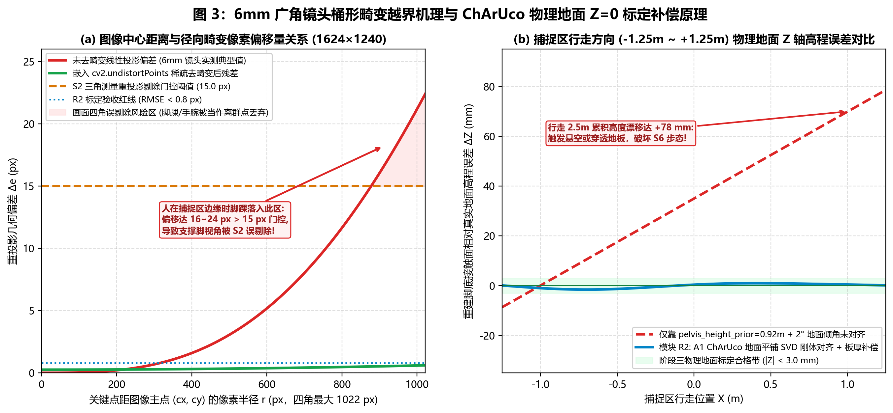
*▲ 图 3：（a）6 mm 广角镜头画面四角径向畸变偏移（达 $16\text{–}24\text{ px}$）越过 `S2` $15.0\text{ px}$ 重投影门控导致支撑脚误剔除的机理，以及嵌入 `cv2.undistortPoints` 后的残差恢复；（b）未标定 $2^\circ$ 地面倾角引起的跨场高程漂移与模块 `R2` ChArUco 地面 $Z=0$ 刚体对齐效果对比。*

---

### 2.3 感知耗时、时序参数与真机控制安全层剖析

1. **视觉前端单步耗时拆解**：
   - 在线 50 Hz 要求视觉 + IK 进程每帧总耗时稳定 **$< 20.0\text{ ms}$**（建议控制在 $15.0\text{ ms}$ 以内）。
   - 目前 `S45c`（关键点方向迁移 + 热启动 Mink IK）单帧仅需 **$\approx 1.3\text{ ms}$**，`S2` + `S3` 合计 **$< 1.0\text{ ms}$**，瓶颈完全集中在：**① 6 路 `BayerRG8` 转 BGR 与仿射切图**、**② 是否每帧运行全图 `YOLOX` 检测**。
   - 当工作区锁定单人后，必须启用 `S1` 的 `TRACK_MODE`（利用上一帧 3D 关键点恒速预测重投影生成切图框，仅将 6 路 $256\times 192$ 切图拼成单个 `Batch=6` 张量送入 TensorRT/CUDA FP16 的 `RTMW`），省去每帧 6 路 `YOLOX` 检测开销。
2. **时序滤波器采样率耦合问题（代码位置：`s3_temporal_filter.py`）**：
   - [`g1_imitation/core/s3_temporal_filter.py`](g1_imitation/core/s3_temporal_filter.py) 中的 `TemporalFilter.filter_frame(points_3d_raw, dt=None)` 已经预留了 `dt` 参数接口，但默认配置与批量入口 `filter_sequence` 仍默认按 `100.0 Hz`（`dt = 0.01 s`）初始化。
   - 在硬件 50 Hz 采集下，必须将相邻两帧真实的相机硬件曝光时间戳之差 $\Delta t_k = t_{\text{dev}, k} - t_{\text{dev}, k-1}$（正常为 $0.020\text{ s}$）显式传入 `filter_frame(points_3d_raw, dt=dt_k)`；同时将 `S2` 的帧间最大位移门控按真实 $\Delta t_k$ 缩放（例如在 100 Hz 下为 $0.25\text{ m}$，在 50 Hz 下对应相同物理速度上限 $25\text{ m/s}$ 的单步门控应随 $\Delta t_k$ 成比例调整，或直接改为最大物理速度门控 `max_joint_speed_m_s`）。
3. **真机开环指令的三大安全缺口**：
   - **缺口 A（初始切入阶跃）**：真机刚启动时处于默认站立姿态 `COMMON_DEFAULT_Q_29`，而操作员可能正处于叉腰、抬手或半蹲姿态。若直接切入，电机将在单步（$20\text{ ms}$）内收到数十度的位置误差，产生满额冲击力矩。虽然 `S45c` 内部有 `startup_blend_s = 0.5 s`（仅在初次骨骼标定结束时触发），但在真机侧（`R4`）必须增加独立的 **2.0 秒软离合（Soft Clutch）**，覆盖任何暂停恢复、跟丢重连场景。
   - **缺口 B（无速度钳位与异常姿态拦截）**：当操作员在视野内跌倒（骨盆高度 $< 0.48\text{ m}$ 或躯干倾角 $> 40^\circ$）时，真机绝对不能模仿跌倒。
   - **缺口 C（超时保持僵死）**：当前 `S3` 与 `S45c` 在观测缺失时保持上一帧输出（Zero-Order Hold）。如果相机网线脱落或操作员走出视野，当时机器人恰处于**单脚迈步悬空状态**，无限期保持单脚悬空参考姿态会挑战 RL 控制器的长期静平衡稳定裕度，必须在超时（$> 35\text{ ms}$ 无新帧或 $> 0.15\text{ s}$ 连续丢失）后平滑回退至双脚对称站立姿态。

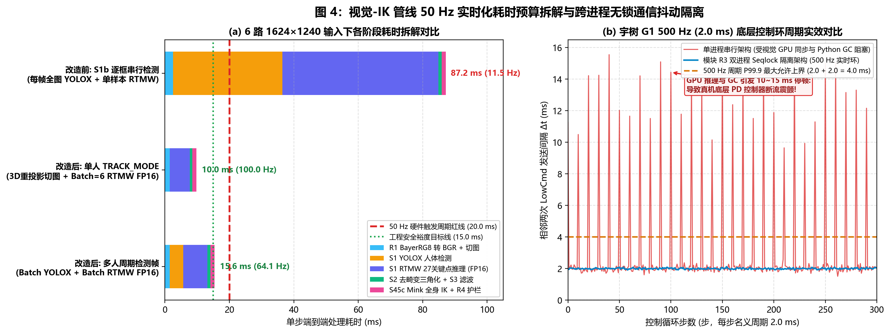
*▲ 图 4：（a）从离线串行 `S1b`（$87.2\text{ ms}$ / $11.5\text{ Hz}$）到在线 `TRACK_MODE` 批量 FP16 推理（$10.0\text{ ms} < 20.0\text{ ms}$ 周期红线）的端到端耗时拆解；（b）单进程架构下的 GC/GPU 周期尖峰与模块 `R3` 双进程 Seqlock 隔离架构下的 $500\text{ Hz}$ 稳定控制周期对比。*

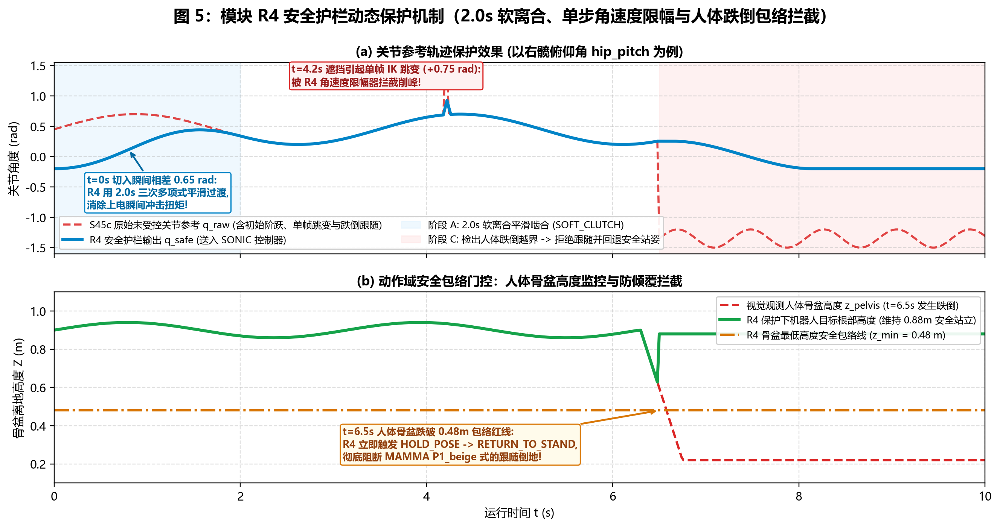
*▲ 图 5：模块 `R4` 安全护栏对三种典型实机危险工况的动态拦截仿真：$t=0\text{–}2\text{ s}$ 软离合平滑啮合消除初始扭矩冲击、$t=4.2\text{ s}$ 拦截遮挡引起的单帧 IK 跳变、$t=6.5\text{ s}$ 检出人体骨盆跌破 $0.48\text{ m}$ 安全包络线并立即拒绝跟随、回退至安全站姿。*

---

## 三、 本机 SDK 环境实测盘点与硬件适配规范

经对当前工作站系统目录、环境变量及项目主虚拟环境（`venv-py311-standalone`）进行实测核查，各模块所需的 SDK 与运行库准备情况如下：

### 3.1 本机 SDK 与依赖库实测状态表

| 所属模块 | 依赖组件 / SDK | 本机当前实测状态 | 核查详情与路径 |
|---|---|---|---|
| **模块 R2（空间标定）** | `cv2.aruco` (`CharucoDetector`) | **已就绪** | `opencv-contrib-python 4.11.0` 已安装，`cv2.aruco.CharucoDetector` 可直接调用 |
| **模块 S1–S6（算法与策略）** | `onnxruntime-gpu`、`mujoco`、`mink`、`numba` | **已就绪** | 版本分别为 `1.22.0`、`3.3.7`、`mink`、`0.68.0`，全部锁定于 `venv-py311-standalone` |
| **模块 R1（海康相机采集）** | **海康机器人 MVS SDK** (`MvCameraControl.dll` + `MvImport`) | **未安装（需准备）** | 系统无 `MVCAM_COMMON_RUNENV` 环境变量，`C:\Program Files (x86)\Common Files\MVS` 不存在 |
| **模块 R3（宇树真机通信）** | **`unitree_sdk2` / `unitree_sdk2_python`** (`cyclonedds`) | **未安装（需准备）** | 虚拟环境中尚未安装 `cyclonedds` 与 `unitree_sdk2py` |

---

### 3.2 海康机器人工业相机 SDK（Hikrobot MVS —— 对应模块 R1）准备与适配

#### （1）安装包获取与必选组件
前往海康机器人官网下载并安装 **MVS (Machine Vision Software) Windows 64位客户端开发包（建议 V4.3.0 及以上版本）**。安装向导中必须勾选：
- **GigE Vision 巨帧过滤驱动（`MvGigEVisionFilter` Driver）**：用于在万兆网卡上绕过 Windows 常规网络栈开销，防止 6 路 50 Hz 并发丢包；
- **二次开发组件（Development / SDK）**：自动部署底层动态库并写入系统环境变量 `MVCAM_COMMON_RUNENV`。

#### （2）Windows 下的绑定机制与零拷贝适配方案
海康官方不通过 PyPI 发布 Python 包。安装 MVS 后：
- C 动态库路径为：`%MVCAM_COMMON_RUNENV%\Samples\Win64\...` 或 `C:\Program Files (x86)\Common Files\MVS\Runtime\Win64_x64\MvCameraControl.dll`；
- 官方 Python 封装源码路径为：`C:\Program Files (x86)\MVS\Development\Samples\Python\MvImport\`（包含 `MvCameraControl_class.py`、`CameraParams_header.py`、`PixelType_header.py` 等 `ctypes` 绑定文件）。

在编写本仓库的 [`g1_imitation/core/r1_hik_capture.py`](g1_imitation/core/) 时，须遵循以下三项适配规范：
1. **运行时环境变量动态挂载**：通过读取 `os.environ.get("MVCAM_COMMON_RUNENV")` 动态将 `MvImport` 挂载至 `sys.path` 并调用 `os.add_dll_directory()`，**不在本仓库中硬拷贝厂商 SDK 源码**。
2. **基于 `MV_CC_GetImageBuffer` 的零拷贝取图与硬时间戳提取**：
   - 调用 `MV_CC_GetImageBuffer(stOutFrame, nMsec)` 获取驱动层环形缓冲区指针 `pBufAddr` 及帧信息结构体 `MV_FRAME_OUT_INFO_EX`；
   - 从结构体中直接读取硬件触发帧号 `nFrameNum` 与 64 位相机内部时钟计数：
     $$\text{dev\_ticks} = (\texttt{nDevTimeStampHigh} \ll 32) \mid \texttt{nDevTimeStampLow}$$
     再除以相机时钟频率（`GevTimestampTickFrequency`，海康 GigE 相机通常为 $10^8\text{ Hz}$ 即 $10\text{ ns/tick}$，需在初始化时读取寄存器确认）换算为精确到微秒的硬件曝光时间戳 `dev_timestamps_s`；
   - 使用 `np.ctypeslib.as_array` 将 `pBufAddr` 映射为 `(1240, 1624)` 的 `uint8` 视图，调用 `cv2.cvtColor(bayer_view, cv2.COLOR_BayerRG2BGR)` 完成彩色转换后，立即调用 `MV_CC_FreeImageBuffer` 归还驱动缓存。
3. **双后端抽象（支持无硬件离线开发与 CI 测试）**：
   - 定义统一协议类 `MultiCameraCaptureBackend`，同时提供 `HikMvsCaptureBackend`（连接真实相机）与 `SimulatedBayerCaptureBackend`（将现有视频/图像序列编码为 `BayerRG8` 并模拟硬件帧号、时钟偏斜与随机丢帧），确保在相机到货前即可通过 `pytest` 完整验收 `R1` 的帧对齐与异常处理逻辑。

---

### 3.3 宇树 G1 EDU 通信 SDK（`unitree_sdk2` —— 对应模块 R3）准备与适配

#### （1）协议版本与消息域（IDL）防错说明
宇树 G1 EDU（29 自由度全身版本）采用基于 **Eclipse CycloneDDS** 的第二代通信架构（`unitree_sdk2`）：
- **必须使用 `unitree_hg` 消息命名空间**（即 `unitree_hg::msg::dds_::LowCmd_` 与 `LowState_`），**严禁混用四足机器狗 Go2 或旧版 H1 的 `unitree_go` 格式**；
- 订阅话题为底层状态 `rt/lowstate`（含 29 个关节电机的位置 `q`、速度 `dq`、估计力矩 `tau_est`）与躯干次级 IMU `rt/secondary_imu`；
- 发布话题为底层控制 `rt/lowcmd`，发送频率为 **500 Hz（每 $2.0\text{ ms}$ 一帧）**，且每帧末尾必须填入通过官方多项式计算出的 **32 位硬件 CRC 校验码（`crc` 字段）**，否则机器人底层电机控制器会直接丢弃指令帧。

#### （2）Windows 平台下的 CycloneDDS 适配难点与两条工程路线
`unitree_sdk2_python`（`https://github.com/unitreerobotics/unitree_sdk2_python`）依赖 `cyclonedds==0.10.2`。在 Windows 系统下直接运行 `pip install cyclonedds` 通常会因缺少预编译的 C 核心动态库 `ddsc.dll` 而报错 `Could not find CycloneDDS`。针对本工作站 Windows 环境，提供两条标准适配路线：

| 对比维度 | **路线 A（推荐生产架构）：C++ `unitree_sdk2` 守护进程 + 共享内存** | **路线 B（纯 Python 架构）：预编译 `ddsc.dll` + `unitree_sdk2_python`** |
|---|---|---|
| **实现方式** | 用本机 MSVC / CMake 编译一个轻量级 C++ 桥接程序（链接官方 C++ `unitree_sdk2`），专职以 500 Hz 收发 DDS `LowState`/`LowCmd` 并计算 CRC32；通过 Windows 命名共享内存与 Python 进程交换状态 | 先用 CMake 编译安装 C 语言版 `eclipse-cyclonedds`（生成 `ddsc.dll` 并设置 `CYCLONEDDS_HOME`），再将 `unitree_sdk2_python` 安装进 `venv-py311-standalone` |
| **实时性与抗抖动** | **极高**：500 Hz 底层通信与看门狗运行在原生 C++ 实时线程中，完全不受 Python GIL、GC 垃圾回收或 ONNX 导入抖动影响 | **中等**：需在独立 Python 进程中用高精度忙等循环（Spin-wait）维持 500 Hz，受操作系统调度与 Python 解释器抖动影响较大 |
| **CRC32 校验性能** | 原生 C++ 单指令周期级计算（复用官方 `crc32_core`） | 需将 CRC32 写成 Numba `@njit` 或 C 扩展，纯 Python 计算耗时过高 |

> **工程建议**：优先采用 **路线 A**（或将 SONIC 50 Hz ONNX 推理与 500 Hz DDS 通信一同放入进程 2，底层 DDS 收发由 C++ 扩展/守护进程承担），可稳妥满足模块 `R3` 控制环路周期偏差 $< 0.2\text{ ms}$、P99.9 抖动 $< 2.0\text{ ms}$ 的验收红线。

#### （3）关节索引顺序映射核对（`SDK Order` vs. `Policy Order`）
在适配 `unitree_sdk2` 时，关节顺序错误是真机调试最常见的危险源。本仓库已完成如下对齐设计：
- [`g1_imitation/core/constants.py`](g1_imitation/core/constants.py) 中的 `G1_29_JOINTS` 以及 [`g1_imitation/config/pipeline_config.json`](g1_imitation/config/pipeline_config.json) 中的 `kp_sdk_order`、`kd_sdk_order`、`default_q_sdk_order`、以及 `S45c` 输出的 `q[7:36]` **已经严格按照宇树 G1 `unitree_hg` SDK 的物理电机编号（0~28）排列**：
  - `0..5`：左腿（`hip_pitch`, `hip_roll`, `hip_yaw`, `knee`, `ankle_pitch`, `ankle_roll`）
  - `6..11`：右腿（`hip_pitch`, `hip_roll`, `hip_yaw`, `knee`, `ankle_pitch`, `ankle_roll`）
  - `12..14`：腰部（`waist_yaw`, `waist_roll`, `waist_pitch`）
  - `15..21`：左臂（`shoulder_pitch`, `shoulder_roll`, `shoulder_yaw`, `elbow`, `wrist_roll`, `wrist_pitch`, `wrist_yaw`）
  - `22..28`：右臂（`shoulder_pitch`, `shoulder_roll`, `shoulder_yaw`, `elbow`, `wrist_roll`, `wrist_pitch`, `wrist_yaw`）
- 而 SONIC 强化学习策略网络内部使用的交错关节顺序 `policy_joint_names` 已在 [`g1_imitation/core/s6_mujoco_closed_loop.py`](g1_imitation/core/s6_mujoco_closed_loop.py) 的 `SonicPolicy` 内部通过索引表自动完成 **SDK 顺序 $\leftrightarrow$ Policy 顺序** 的双向转换。
- **结论**：模块 `R3` 在封装 `LowState.motor_state[i]` 读取与 `LowCmd.motor_cmd[i]` 下发时，**直接按 `i = 0..28` 一一对应赋值即可，严禁在 `R3` 中二次打乱关节顺序**。

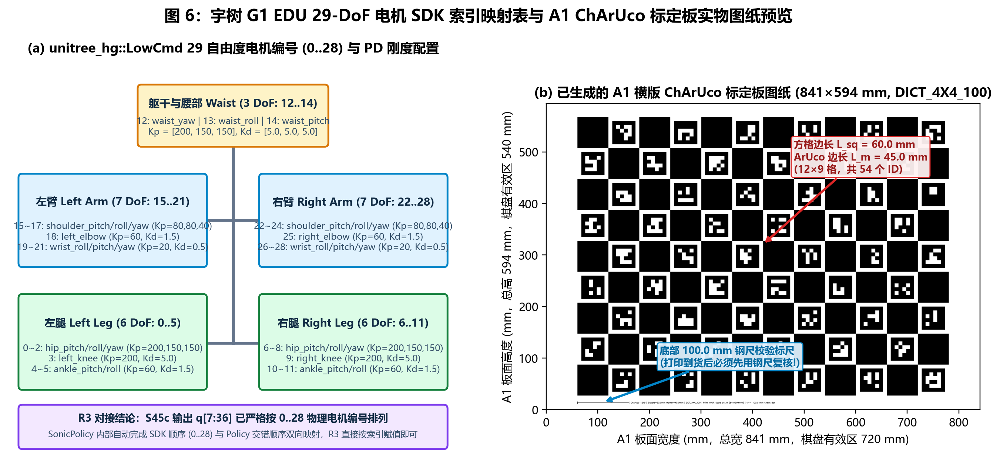
*▲ 图 6：（a）宇树 G1 EDU `unitree_hg::LowCmd` 29 自由度物理电机索引（`0..28`）与各部位 PD 刚度/阻尼参数映射树；（b）已生成并归档于 `data/deployment_bundle/calibration/` 的 300 DPI A1 横版 ChArUco 标定板原大图纸预览（含底部 $100.0\text{ mm}$ 钢尺校验标尺）。*

---

## 四、 具体工程执行手册（Step-by-Step Execution Manual）

本执行手册按**五个阶段（Phase 1 ~ Phase 5）**编排。每个阶段均包含操作规程、模块接口契约及量化验收方法。

---

### 阶段一（Phase 1）：场地勘测、双网隔离与硬件同步台架搭建

#### 4.1.1 场地空间与相机安装几何核定
根据海康 `MV-CS020-10GC`（靶面尺寸 $7.31\text{ mm} \times 5.58\text{ mm}$，分辨率 $1624 \times 1240$）与 `MVL-KF0618M-12MPE`（焦距 $f = 6\text{ mm}$）计算，相机距捕捉区中心水平距离 $D$ 与垂直无裁切高度 $H_{\text{cov}}$ 的关系为：

| 安装方式 | 水平视场角 $\text{FOV}_H$ | 垂直视场角 $\text{FOV}_V$ | 相机距中心 $D$ | 中心平面覆盖宽 $\times$ 高 | 适用实验室场地面积 | 中心全身有效活动区 |
|---|---|---|---|---|---|---|
| **标准横装** | $62.7^\circ$ | $49.9^\circ$ | $2.8\text{–}3.5\text{ m}$ | $(3.40 \times 2.60)\text{ m} \sim (4.25 \times 3.25)\text{ m}$ | $\ge 4.0\text{ m} \times 4.0\text{ m}$ | $2.0\text{ m} \times 2.0\text{ m} \sim 2.5\text{ m} \times 2.5\text{ m}$ |
| **旋转 $90^\circ$ 竖装** | $49.9^\circ$ | $62.7^\circ$ | $2.0\text{–}2.4\text{ m}$ | $(1.86 \times 2.43)\text{ m} \sim (2.23 \times 2.92)\text{ m}$ | $3.2\text{ m} \times 3.2\text{ m}$ 紧凑场地 | $1.2\text{ m} \times 1.2\text{ m} \sim 1.5\text{ m} \times 1.5\text{ m}$ |

**执行要求**：
1. 在实验室地面用高对比度胶带贴出：**① 中心有效捕捉区边界**、**② 四角（或六机位）三脚架落脚点**、**③ 宇树 G1 机器人及龙门保护吊架独立安全区（位于捕捉视野外至少 $1.0\text{ m}$）**。
2. 4 盏 100W 无频闪 LED 常亮补光灯布置在四角相机后上方（避免直射正对侧相机镜头造成眩光），确保在 $1.5\text{–}2.0\text{ ms}$ 曝光下人体衣物纹理清晰且背景无频闪条纹。

#### 4.1.2 工作站双网卡物理隔离与巨帧配置
将 `Intel X550-T1` 万兆网卡插入工作站 PCIe x4/x8 插槽，严格按以下拓扑划分网段：

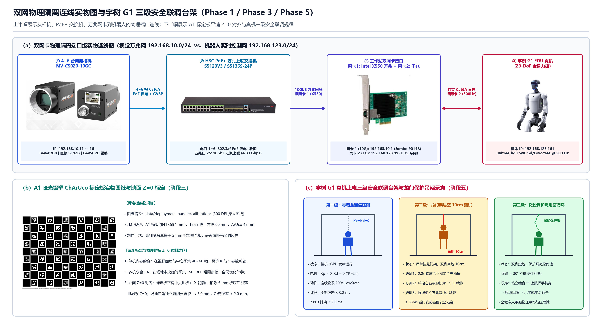
*▲ 设备图鉴 3：（a）从海康相机、H3C PoE+ 交换机、工作站双网卡（Intel X550 万兆口 + 主板千兆口）到宇树 G1 真机的端口级实物连线图；（b）A1 哑光铝塑 ChArUco 标定板实物与地面 $Z=0$ 对齐；（c）宇树 G1 真机三级安全联调龙门吊架示意。*

```text
[4~6 台海康相机] --(Cat6A PoE)--> [H3C S1510FX-UP 交换机] --(10GbE 万兆口)--> [网卡 1: Intel X550-T1 (192.168.10.1/24)]
[宇树 G1 EDU 机器人] <-----------(独立 Cat6A 网线直连)----------------------> [网卡 2: 主板自带千兆口 (192.168.123.99/24)]
```

**Windows 工作站网络配置步骤**：
1. 在“网络连接”中将两块网卡分别重命名为 `NIC_CAM_10G` 与 `NIC_G1_DDS`。
2. 配置 `NIC_CAM_10G` 静态 IP 为 `192.168.10.1`，子网掩码 `255.255.255.0`，不填默认网关；4–6 台相机静态 IP 依次设为 `192.168.10.11` ~ `192.168.10.16`。
3. 打开 `NIC_CAM_10G` 的“属性 → 配置 → 高级”：
   - 将 **巨型帧（Jumbo Packet）** 设为 `9014 Bytes`；
   - 将 **接收缓冲区（Receive Buffers）** 调至最大值（通常为 `2048` 或 `4096`）；
   - 将 **中断节流率（Interrupt Moderation Rate）** 设为 `Low` 或 `Adaptive`，关闭网卡节能（EEE / Green Ethernet）。
4. 在海康 MVS 客户端中勾选 `NIC_CAM_10G` 的 **巨帧驱动 / Filter Driver（`MvGigEVisionFilter`）**，使图像 GVSP 数据包绕过 Windows 常规 TCP/IP 协议栈直接进入环形缓冲区。

#### 4.1.3 硬件同步触发源制作与接线验证

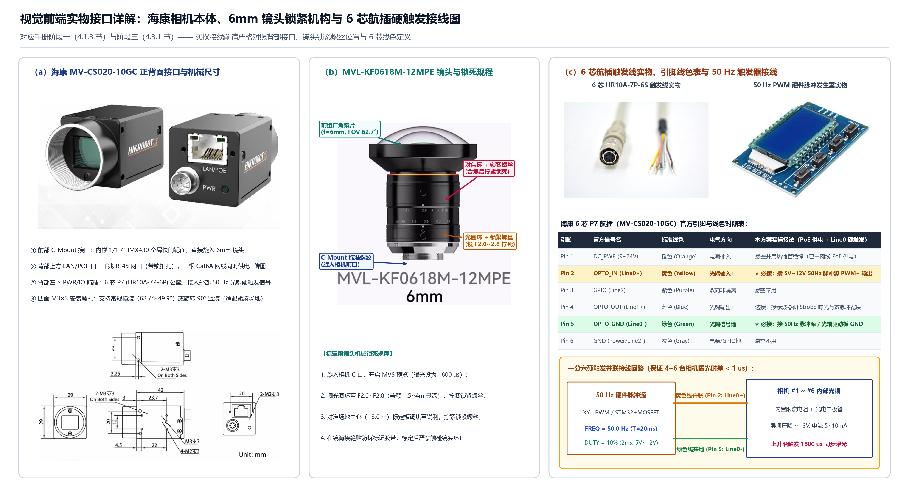
*▲ 设备图鉴 2：（a）海康 `MV-CS020-10GC` 正背面实物接口与机械尺寸图；（b）`MVL-KF0618M-12MPE` 6mm 镜头对焦环/光圈环手拧锁紧螺丝位置标注；（c）6 芯 `HR10A-7P-6S` 触发线实物、官方线色定义与 50 Hz 硬件脉冲发生器一分六并联接线图。*

1. **航插线引脚与线色核对**：海康 `MV-CS020-10GC` 背部 6 芯 P7（`HR10A-7R-6P`）接口配合官方 6 芯触发线（`HR10A-7P-6S`）的标准定义如下（接线前请用万用表通断档二次核实，严禁将电源线误接至光耦引脚）：

| 航插引脚号 | 官方信号名称 | 标准导线颜色 | 电气类型 | 本方案（PoE 供电 + 硬触发）标准接法 |
|---|---|---|---|---|
| **Pin 1** | `DC_PWR` ($9\text{–}24\text{ V}$) | **橙色（Orange）** | 直流电源正极 | **悬空并用热缩管独立绝缘包裹**（相机已由网口 PoE 供电） |
| **Pin 2** | `OPTO_IN` (**`Line0+`**) | **黄色（Yellow）** | 光耦隔离输入正极 | **★ 必接**：并联接至 $50\text{ Hz}$ 脉冲发生器 / 光耦驱动板的 **$5\text{–}12\text{ V}$ `PWM+` 输出端** |
| **Pin 3** | `GPIO` (`Line2`) | **紫色（Purple）** | 双向非隔离 I/O | 悬空不用 |
| **Pin 4** | `OPTO_OUT` (`Line1+`) | **蓝色（Blue）** | 光耦隔离输出正极 | 选接：在同步验收时接示波器测量相机 `ExposureActive` 实际曝光脉冲 |
| **Pin 5** | `OPTO_GND` (**`Line0-`** / `Line1-`) | **绿色（Green）** | 光耦隔离信号地 | **★ 必接**：并联接至 $50\text{ Hz}$ 脉冲发生器 / 光耦驱动板的 **`GND` 共地端** |
| **Pin 6** | `GND` (`Power` / `Line2-`) | **灰色（Gray）** | 直流电源与 GPIO 地 | 悬空不用 |

2. **脉冲发生器配置**：
   - 频率：$f_{\text{trig}} = 50.00\text{ Hz}$（周期 $T = 20.000\text{ ms}$）；
   - 占空比：$10\%$（高电平脉宽 $2.0\text{ ms}$，上升沿触发）；
   - 驱动电平：经推挽/MOSFET 分配板输出 $5\text{ V}$ 或 $12\text{ V}$ 并联至各路**黄色线（`Pin 2: Line0+`）**，共地端接各路**绿色线（`Pin 5: Line0-`）**。
3. **阶段一验收方法**：
   - 使用双通道示波器同时测量第 1 路与第 6 路相机末端的触发上升沿，要求边沿陡峭（上升时间 $< 5\text{ }\mu\text{s}$），通道间相位差 **$< 1\text{ }\mu\text{s}$**。

---

### 阶段二（Phase 2）：多路相机硬同步采集适配器开发（模块 R1）

#### 4.2.1 海康相机内部寄存器标准配置表
在模块 `R1` 初始化时，必须通过海康 MVS SDK（`MvCameraControl_class`）按顺序写入以下参数（6 台 50 Hz 模式）：

| 参数名称（GenICam 节点） | 设定值 | 工程作用解释 |
|---|---|---|
| `PixelFormat` | `BayerRG8` (`0x01080009`) | 传输单通道 8-bit 原始拜耳阵列，带宽降至 `RGB8` 的 $1/3$ |
| `AcquisitionMode` | `Continuous` | 连续采集态，等待外部硬件触发信号 |
| `TriggerMode` | `On` | 开启触发模式（严禁使用 `Off` 自由运行模式） |
| `TriggerSource` | `Line0` | 绑定物理光耦输入引脚 `Line0` |
| `TriggerActivation` | `RisingEdge` | 上升沿同时触发曝光 |
| `ExposureAuto` | `Off` | 关闭自动曝光（自动曝光会导致各帧曝光时长变动，破坏运动模糊一致性） |
| `ExposureTime` | `1800.0` ($\mu\text{s}$) | 锁死 $1.8\text{ ms}$ 短曝光，确保 $5\text{ m/s}$ 快速挥手位移模糊 $< 9\text{ mm}$ |
| `GainAuto` | `Off`（手动固定增益） | 配合场地常亮补光灯手动设定固定增益（建议 $\le 6\text{ dB}$） |
| `GevSCPSPacketSize` | `8192` (Bytes) | 匹配万兆网卡与交换机巨帧，降低中断频率 |
| `GevSCPD`（包间延迟） | 按相机编号错峰设定 | 消除 6 台相机曝光结束瞬间的 UDP 微突发拥塞 |

> **错峰发包参数检查**：也可直接使用海康 SDK 提供的 `MV_GIGE_SetGevSCPD` 与带宽分配接口，使 6 台相机的每帧 $2.01\text{ MB}$ 数据在曝光结束后的 $0\text{–}6\text{ ms}$ 窗口内均匀到达万兆网卡。

#### 4.2.2 模块 R1 接口契约（新建目标：`g1_imitation/core/r1_hik_capture.py`）
严格遵循 [`AGENTS.md`](AGENTS.md) 第一条约定：

- **输入（Input）**：
  - 相机序列号列表 `camera_serials: tuple[str, ...]`（长度 $N \in [2, 6]$）；
  - 采集配置字典（曝光微秒数、增益、巨帧包长、允许最大曝光偏斜 `max_exposure_skew_ms = 1.0`、帧组装超时 `bundle_timeout_ms = 12.0`）。
- **输出（Output）**：`SynchronizedFrameBundle` 数据类
  - `bundle_id: int`：严格递增的硬件触发序号；
  - `images_bgr: np.ndarray`：形状 `(N_cams, H, W, 3)`，类型 `uint8`（主机端或 GPU 端由 `BayerRG8` 转换后的 BGR 图像；缺失视角对应切片置零并通过掩码标记）；
  - `valid_cam_mask: np.ndarray`：形状 `(N_cams,)`，类型 `bool`（标识该视角在当前触发号下是否成功按时到达且未损坏）；
  - `dev_timestamps_s: np.ndarray`：形状 `(N_cams,)`，类型 `float64`，单位**秒（s）**，由相机硬件时钟计数器 `nDevTimeStampHigh/Low` 换算（缺失视角填 `np.nan`）；
  - `host_monotonic_s: float`：主机 `time.perf_counter()` 单调时钟时间戳，单位**秒（s）**；
  - `exposure_time_s: float`：实际硬件曝光时长，单位**秒（s）**。
- **时间基准（Time Base）**：
  - 帧间同步判定与时序滤波 $\Delta t$ 步长以**相机硬件设备时间戳 `dev_timestamps_s`**（经 PTP / 初始触发对齐）为准；
  - 跨进程看门狗超时检测以**主机单调时钟 `host_monotonic_s`** 为准。
- **失败行为（Failure Behavior）**：
  - **严禁把主机接收时间冒充为相机曝光时间**；
  - 若某台相机在 `bundle_timeout_ms` 内未返回对应 `nFrameNum` 的图像，或该相机 `dev_timestamp` 与同组中位数偏差 $> 1.0\text{ ms}$，则仅将该相机的 `valid_cam_mask[c]` 置为 `False`、`keypoints_2d[c]` 后续置零/NaN，其余正常相机继续进入 `S1–S2`；
  - 若当帧有效相机总数 $< 2$，整帧标记为 `bundle_valid = False`，下游模块保持上一安全状态，**绝不用上一帧旧图像拼接成“伪同步帧”**。

#### 4.2.3 阶段二量化验收方法
1. **光学同步精度测试**：将 4–6 台相机同时对准一台以 $1000\text{ Hz}$ 刷新的高精度 LED 数码毫秒表（或手机/平板运行的 $120/240\text{ Hz}$ 逐帧格雷码条码图案 + 示波器 `Strobe Out` 曝光有效输出引脚），连续抓拍 $1000$ 组同步帧：
   - 同一 `bundle_id` 下所有相机的曝光有效电平重叠度偏差必须 **$< 1.0\text{ ms}$**（硬触发下实测通常 $< 0.05\text{ ms}$）。
2. **30 分钟稳定性压测**：以 $50\text{ Hz}$ 连续采集 $30\text{ 分钟}$（共 $90,000$ 组同步帧），统计：
   - 丢帧数 $= 0$；
   - 错位组装帧数 $= 0$；
   - 从曝光结束到 `SynchronizedFrameBundle` 完成 Debayer 输出的耗时 P99 **$< 4.0\text{ ms}$**。

---

### 阶段三（Phase 3）：空间标定与物理地面 $Z=0$ 强制对齐（模块 R2）

#### 4.3.1 镜头机械锁死规程（标定前红线）
1. 在 MVS 客户端开启实时预览，将标定板置于场地中心（距各相机约 $2.8\text{–}3.2\text{ m}$），调节对焦环使标定板角点边缘最锐利；
2. 调节光圈环（建议设在 `F2.0 ~ F2.8` 之间，兼顾通光量与景深，确保从距相机 $1.5\text{ m}$ 到 $4.0\text{ m}$ 均清晰合焦）；
3. **拧紧镜头上的对焦锁紧手拧螺丝与光圈锁紧螺丝**，并在接缝处贴上防拆标记胶带。一旦锁死并完成标定，实验期间严禁触碰镜头环或移动三脚架。

#### 4.3.2 模块 R2 标定流程与地面对齐数学规范（新建目标：`scripts/calibrate_physical_cameras.py`）
模块 `R2` 分三步生成标定文件 `outputs/calibration/physical_cameras.json`，彻底取代离线 `pelvis_height_prior_m`：

1. **步骤 A（单机内参与 5 参数畸变标定）**：
   - 手持 A1 铝塑哑光 ChArUco 标定板（已知方格精确物理边长 $L_{\text{sq}}$，单位：米），在每台相机视野的中心、四角及不同倾斜角度下各采集 $40\text{–}60$ 张图像；
   - 解算每台相机的内参矩阵 $\mathbf{K}_c \in \mathbb{R}^{3\times 3}$ 与 OpenCV 标准 5 参数畸变向量 $\mathbf{d}_c = [k_1, k_2, p_1, p_2, k_3]^\top$。
2. **步骤 B（多视角联合外参光束法平差 Bundle Adjustment）**：
   - 手持标定板在中央活动区缓慢移动并旋转，采集 $150\text{–}300$ 组多机共视同步帧；
   - 通过 PnP 初始化并运行鲁棒稀疏光束法平差（最小化去畸变后的全局 2D 重投影残差），获得以 0 号相机或临时参考系为基准的初始外参 $[\mathbf{R}_c^{(0)} \mid \mathbf{t}_c^{(0)}]$。
3. **步骤 C（物理地面 $Z=0$ 平面强制刚体对齐）**：
   - 将 ChArUco 标定板**平铺在活动区正中央的物理地板上**，板面标示出的 $+X$ 轴指向房间正前方（与机器人预设朝向一致），采集 20 组静态同步帧；
   - 利用多视角三角化求出标定板上所有角点在临时参考系下的三维坐标 $\{\mathbf{P}_i^{(0)}\}$，通过 SVD 拟合地面平面法向量 $\mathbf{n}_{\text{floor}}$（指向天顶）及原点 $\mathbf{O}_{\text{floor}}$，构造全局刚体变换矩阵 $\mathbf{T}_{\text{align}} = [\mathbf{R}_{\text{align}} \mid \mathbf{t}_{\text{align}}] \in SE(3)$；
   - 更新所有相机的世界到相机外参：
     $$\begin{bmatrix} \mathbf{R}_c & \mathbf{t}_c \\ \mathbf{0}^\top & 1 \end{bmatrix} = \begin{bmatrix} \mathbf{R}_c^{(0)} & \mathbf{t}_c^{(0)} \\ \mathbf{0}^\top & 1 \end{bmatrix} \mathbf{T}_{\text{align}}^{-1}$$
   - 修正常数偏置（减去标定板铝塑板自身物理厚度 $h_{\text{board}}$，例如 $5.0\text{ mm}$），使得**物理地板表面严格满足 $Z = 0.000\text{ m}$**，右手坐标系 $+X$ 朝前、$+Y$ 朝左、$+Z$ 竖直向上。

#### 4.3.3 模块 R2 接口契约与验收标准
- **输入**：同步标定图像序列、ChArUco 字典与物理尺寸（米）、标定板板厚 $h_{\text{board}}$（米）。
- **输出**：结构化 JSON 标定文件，包含每台相机的 `serial`、`image_size_wh`、`K` ($3\times 3$)、`dist_coeffs` ($5,$)、`R_w2c` ($3\times 3$)、`t_w2c` ($3,$)、线性投影矩阵 `P` ($3\times 4$)、`calibration_timestamp_utc` 及 `reprojection_rmse_px`。
- **失败行为**：若任一相机平均重投影误差 $\ge 0.8\text{ px}$，或地面检查点 $Z$ 残差 $\ge 3.0\text{ mm}$，脚本抛出异常并拒绝生成标定文件。
- **独立物理验证（阶段三验收红线）**：
  1. 将标定板依次平放在活动区**正中心**与**四个角落**的地板上（这 4 个角落位置不参与步骤 C 的外参拟合）；
  2. 用模块 `S2` 三角化角点的三维坐标，要求所有地面角点的 **$Z$ 坐标绝对值偏差 $< 3.0\text{ mm}$**，且板面已知两角点间的三维欧氏距离误差 **$< 2.0\text{ mm}$**。

---

### 阶段四（Phase 4）：现有代码库（S1–S5）在线化与安全约束改造手册

> **说明**：本阶段全部为纯软件改造，**不需要等待海康相机到货**，可立即利用合成畸变相机测试集与现有单元测试在本地开发并完成回归验收。

#### 4.4.1 改造项 1：在 `S1` 与 `S2` 之间嵌入稀疏 2D 关键点去畸变
- **修改目标**：[`g1_imitation/core/s1_vision_tracker.py`](g1_imitation/core/s1_vision_tracker.py) 与 [`g1_imitation/core/s2_triangulation.py`](g1_imitation/core/s2_triangulation.py)。
- **具体方法**：
  1. 新增纯函数 `undistort_keypoints_2d(keypoints_2d: np.ndarray, K_matrices: np.ndarray, dist_coeffs: np.ndarray) -> np.ndarray`：
     - 输入：形状 `(N_cams, 27, 3)` 的原始畸变像素坐标 `[u_dist, v_dist, conf]`，内参 `(N_cams, 3, 3)`，畸变系数 `(N_cams, 5)`；
     - 对每台 `dist_coeffs[c]` 非全零的相机，调用 `cv2.undistortPoints(uv_c.reshape(-1, 1, 2), K_matrices[c], dist_coeffs[c], P=K_matrices[c])`，输出理想线性针孔平面上的 `[u_rect, v_rect, conf]`；
     - 当 `dist_coeffs` 为 `None` 或全零时（兼容现有无畸变仿真测试），直接原样返回，保证 64 项现有测试零回归。
  2. 在 `S1` 的 `TRACK_MODE` 重投影计算切图框时，先用线性 $\mathbf{P}_c$ 投影预测 3D 点，或通过 `cv2.projectPoints` 带上 `dist_coeffs[c]` 投影至真实畸变图像平面，确保在广角边缘切图框不偏离人体。

#### 4.4.2 改造项 2：`S1` / `S1b` 50 Hz 批量推理与追踪状态机联通
- **修改目标**：[`g1_imitation/core/s1_vision_tracker.py`](g1_imitation/core/s1_vision_tracker.py) 与 [`g1_imitation/core/s1b_person_association.py`](g1_imitation/core/s1b_person_association.py)。
- **具体方法**：
  1. **单人操作模式（默认实验室受控场地）**：一旦 `S1b` 完成工作区内唯一操作员初始锁定且上一帧有效 3D 点数 $\ge 14$，直接走 `S1` 的 `TRACK_MODE`（3D 恒速重投影切图 + 单次 `Batch=N_cams` 的 `RTMW` FP16 推理），跳过每帧 `YOLOX` 全图检测；每隔 $K=25\text{ 帧}$（$0.5\text{ s}$）或当平均置信度 $< 0.45$ 时触发一次 `YOLOX` 校验。
  2. **多人/抗干扰模式**：将 `s1b_person_association.py` 中 `extract_candidates_from_images` 的逐框循环调用 `RTMW` 改为**将所有相机视角的候选切图拼接成单一 Batch 张量 `(M_total_crops, 3, 256, 192)`** 一次性调用 `ort_session.run()`，消除多次 GPU Kernel 启动开销。

#### 4.4.3 改造项 3：`S2` / `S3` 动态时间戳 $\Delta t$ 驱动
- **修改目标**：[`g1_imitation/core/s2_triangulation.py`](g1_imitation/core/s2_triangulation.py)、[`g1_imitation/core/s3_temporal_filter.py`](g1_imitation/core/s3_temporal_filter.py) 与 [`g1_imitation/config/pipeline_config.json`](g1_imitation/config/pipeline_config.json)。
- **具体方法**：
  1. 在在线流式调用中，将 `R1` 输出的相机设备时间戳差值 `dt_s = current_dev_ts - prev_dev_ts` 显式传入 `TemporalFilter.filter_frame(points_3d_raw, dt=dt_s)`；
  2. 将 `S2` 的帧间位移门控 `max_displacement_m` 与 `dt_s` 关联：$\Delta d_{\max}(t) = v_{\max} \cdot \Delta t_k$（其中 $v_{\max} = 25.0\text{ m/s}$ 对应原先 $100\text{ Hz}$ 下的 $0.25\text{ m}$），使 $50\text{ Hz}$、$60\text{ Hz}$ 与 $100\text{ Hz}$ 具有完全一致的物理速度门控意义；
  3. 操作员上场静立标定阶段（前 $0.5\text{ s}$），不仅在 `S45c` 中统计人体腿长，同时取双脚跟/脚趾 6 个关键点的高度第 10 百分位数自动更新 `S3` 的鞋底基准厚度 $z_{\text{nominal}}$。

#### 4.4.4 改造项 4：新增因果轨迹约束器与动作域安全包络（新建目标：`g1_imitation/core/r4_safety_governor.py`）
位于 `S45c`（关键点 IK）输出之后、送入 `S6`/`R3` 控制器之前，严格定义接口契约：

- **输入**：
  - `ik_frame: KeypointIKFrame`（来自 `S45c` 的 `q(36,)`、`dq(35,)`、`observed: bool`）；
  - `human_points_3d: np.ndarray`（形状 `(27, 3)`，单位：米）；
  - `t_host_s: float`（主机单调时间，单位：秒）。
- **输出**：`SafeReferenceFrame`
  - `q_safe: np.ndarray`（形状 `(36,)`，经软离合、速度限幅与动作域钳位后的安全参考姿态）；
  - `dq_safe: np.ndarray`（形状 `(35,)`，安全参考速度）；
  - `safety_state: str`（枚举：`"IDLE_STAND"` | `"SOFT_CLUTCH"` | `"ACTIVE_TRACK"` | `"HOLD_POSE"` | `"RETURN_TO_STAND"`）；
  - `fault_reason: str | None`。
- **核心保护逻辑**：
  1. **动作域安全包络检查（解决 G08 倒地跟随问题）**：
     - 若人体骨盆中心高度 $z_{\text{pelvis}} < 0.48\text{ m}$（跌倒/坐地）或躯干倾角 $\theta_{\text{trunk}} > 40^\circ$，拒绝更新该帧目标，切入 `"HOLD_POSE"` 并记录 `fault_reason = "human_out_of_envelope"`。
  2. **关节角速度硬件限幅（解决 G07 跳变冲击问题）**：
     - 对每步关节参考增量施加上限：$\|\Delta \mathbf{q}_{\text{joint}}\|_\infty \le \dot{q}_{\max} \cdot \Delta t$（默认单步 $20\text{ ms}$ 内最大关节角变化 $\le 0.20\text{ rad}$，若输入原始跳变 $> 0.35\text{ rad}$ 则直接触发看门狗锁定）。
  3. **超时分级回退（解决单脚悬空僵死问题）**：
     - 观测丢失 $\le 0.15\text{ s}$：短暂保持上一安全姿态（速度归零）；
     - 观测丢失 $> 0.15\text{ s}$：启动 $1.5\text{ s}$ 平滑插值，将参考姿态从当前姿态平稳收回到双脚对称默认站姿 `COMMON_DEFAULT_Q_29`。

---

### 阶段五（Phase 5）：双进程共享内存、DDS 对接与真机吊架安全联调（模块 R3 & R4）

#### 4.5.1 模块 R3：双进程无锁共享内存与 `unitree_sdk2` 对接
为彻底隔离视觉/IK 计算抖动，实机运行拆分为两个独立操作系统进程：

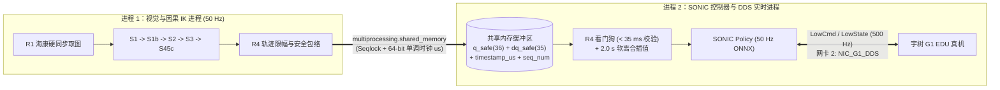

- **共享内存结构体（Seqlock 无锁读写）**：
  - `seq: uint64`（写前加 1 变奇数，写后加 1 变偶数；读进程发现奇数或前后 `seq` 不一致则重试，零互斥锁阻塞）；
  - `timestamp_monotonic_us: int64`（帧生成时刻的主机单调时钟微秒数）；
  - `safety_state_code: int32`；
  - `q_safe: float64[36]`；
  - `dq_safe: float64[35]`。
- **进程 2 实时性保障**：
  - 在进程 2 启动时强制设置 `os.environ["OPENBLAS_NUM_THREADS"] = "1"`、`os.environ["OMP_NUM_THREADS"] = "1"`，并将进程优先级设为 `HIGH_PRIORITY_CLASS`；
  - 通过 `unitree_sdk2` 的 `unitree_hg` 消息接口订阅 `rt/lowstate` 与躯干 `rt/secondary_imu`，以 $50\text{ Hz}$ 运行 SONIC ONNX 策略，以底层电机 PD 环执行力矩控制。

#### 4.5.2 真机上电三级安全联调 SOP（严禁跳级）

在将代码连接到宇树 G1 真机时，必须严格按以下三个递进步骤执行，任何一步未达标立即停机排查：

1. **第一级：电机失能（Damping / 零增益）通信环路压测**
   - **操作**：开启 4–6 台相机与 GPU 满负载运行进程 1，同时启动进程 2 连接真机读取 `LowState`，但将下发的 `LowCmd` 增益 $K_p, K_d$ 全部置零（电机不出力）。
   - **验收指标**：连续记录 $10,000$ 次控制循环（$200\text{ s}$），进程 2 的平均周期偏差必须 **$< 0.2\text{ ms}$**，$99.9\%$ 分位最大单次卡顿（P99.9 Jitter）**$< 2.0\text{ ms}$**。
2. **第二级：龙门保护吊架悬空测试（双脚离地 $10\text{ cm}$）**
   - **操作**：将宇树 G1 悬挂于龙门保护吊架上，双脚完全离地 $10\text{ cm}$，专人手持物理急停开关（及遥控器阻尼键）。
   - **必测科目**：
     1. **2.0 秒软离合啮合测试**：操作员站在捕捉区摆出双臂平举姿态，触发啮合指令，观察机器人是否在 $2.0\text{ s}$ 内平滑抬臂到位，无任何扭矩抽搐；
     2. **镜像与轴向核对**：操作员依次单抬左臂、单抬右臂、单抬左腿、单抬右腿、左转腰、前倾躯干，核对机器人左右肢体是否 1:1 严格对应（非镜面反转）、关节旋转正负方向是否与仿真完全一致；
     3. **拔网线看门狗熔断测试（核心安全必测）**：在跟随过程中，**直接拔掉交换机到主机的万兆网线（或拔掉单台相机触发线）**，验证进程 2 是否在 **$\le 35\text{ ms}$** 内检出时间戳过期、立即切断增量跟随并平滑回退至阻尼安全姿态。
3. **第三级：地面微松保护绳闭环测试**
   - **操作**：缓降吊架使机器人双脚平稳接触实验室地面，保护绳保持微松（允许机器人正常重心起伏与迈步，但在倾角 $> 30^\circ$ 时能立刻兜住机身）。
   - **必测科目**：原地站立啮合 → 上肢挥手与转身 → 原地深蹲起立 → 原地踏步 → 捕捉区内小步幅前后行走。

---

## 五、 前期工作推进清单与优先级排序（Actionable Checklist）

为了最高效地推进项目，建议将前期任务划分为**“A 线：立即可在本地仓库编写并测试的软件与 SDK 适配准备”**与**“B 线：伴随硬件采购与到货的物理联调”**两条并行主线：

### A 线：代码库先行改造与 SDK 适配任务（无需等待硬件到货，可立即启动）
- [ ] **任务 A1（光学畸变兼容）**：在 `S1`/`S2` 中补齐 `dist_coeffs` 稀疏 2D 关键点去畸变函数 `undistort_keypoints_2d`，并用合成径向畸变投影点编写 `pytest` 单元测试，验证去畸变后三角化误差恢复至 $< 10\text{ mm}$。
- [ ] **任务 A2（标定工具链 R2）**：基于本机已就绪的 `cv2.aruco.CharucoDetector`，编写 `scripts/calibrate_physical_cameras.py`（支持 ChArUco 板角点检测、多机内参/畸变/外参 BA 优化、以及地面平铺角点 $Z=0$ 强制刚体对齐），并用仿真合成的棋盘格多视角图像跑通全流程测试。
- [ ] **任务 A3（安全护栏与轨迹限幅 R4）**：编写 `g1_imitation/core/r4_safety_governor.py`，实现 $2.0\text{ s}$ 软离合、单步角速度限幅（$\le 0.35\text{ rad}$）、人体倒地包络拦截（$z_{\text{pelvis}} < 0.48\text{ m}$ 或倾角 $> 40^\circ$）及超时回退站姿，并在 MAMMA 倒地片段与丢帧注入测试上验证机器人不再跟随倒地。
- [ ] **任务 A4（50 Hz 批量推理与动态 $\Delta t$）**：联调 `S1` 的 `TRACK_MODE` 批量推理与 `S2`/`S3` 的动态 $\Delta t$ 时间戳接口，在本机 RTX 4090 上实测 4 路与 6 路 $1624 \times 1240$ 图像的端到端单步延迟。
- [ ] **任务 A5（海康 MVS 与宇树 `unitree_sdk2` 双后端适配骨架 R1 & R3）**：
  - 安装海康 MVS Windows 64位客户端开发包，完成 `g1_imitation/core/r1_hik_capture.py` 的 `HikMvsCaptureBackend` 与 `SimulatedBayerCaptureBackend` 封装及单元测试；
  - 搭建 `R3` Seqlock 共享内存通信模块与 `unitree_hg` (`LowCmd`/`LowState` + CRC32) 桥接接口，在不插真机的情况下跑通进程 1 与进程 2 的 $50\text{ Hz} / 500\text{ Hz}$ 跨进程闭环测试与抖动统计。

### B 线：硬件采购与物理台架联调任务
- [ ] **任务 B1**：核查工作站空闲 PCIe 插槽与实验室场地尺寸，确认 4 机（或 6 机）采用横装还是 $90^\circ$ 竖装。
- [ ] **任务 B2**：先行到位 2 台海康 `MV-CS020-10GC` + 6mm 镜头 + STM32 光耦触发分配板 + 补光灯 + A1 ChArUco 标定板，完成 $1.8\text{ ms}$ 短曝光画质与硬件微秒级同步验证。
- [ ] **任务 B3**：到位全部 4–6 台相机、H3C 万兆上联 PoE+ 交换机与 Intel X550 万兆网卡，跑通 **阶段二（30 分钟零丢帧压测）** 与 **阶段三（全场地面 $Z=0$ 标定验收）**。
- [ ] **任务 B4**：严格按 **阶段五三级安全联调 SOP** 完成宇树 G1 悬空吊架测试与地面跟随验收。

---

## 六、 跨工作站部署离线资源包（`data/deployment_bundle/`）与迁移指南

考虑到实际部署很可能在**另一台独立工作站（如实验室 Ubuntu 22.04/24.04 Linux 主机或新的 Windows 工作站）**上进行，而当前 [`g1_imitation/config/pipeline_config.json`](g1_imitation/config/pipeline_config.json) 中的模型权重与机器人资产默认指向本机用户缓存目录（`C:\Users\TanWei\AppData\Local\...` 与 `C:\Users\TanWei\.cache\rtmlib\...`），直接拷贝代码仓库会导致新机器缺失模型与 SDK。

为此，已在项目根目录下被 `.gitignore` 忽略的 [`data/deployment_bundle/`](data/deployment_bundle/README.md) 目录中预先下载并归档了全套跨平台离线部署资源包（保持 Git 仓库干净的同时，支持随文件夹整体迁移）：

### 6.1 已下载并归档的离线资源清单

| 子目录 / 文件 | 体积 / 状态 | 包含内容与工程用途 |
|---|---|---|
| [`data/deployment_bundle/sdks/unitree_sdk2/`](data/deployment_bundle/sdks/unitree_sdk2) | 已克隆完整仓库 | 宇树官方 G1 EDU C++ DDS SDK 源码（含 `unitree_hg` 29-DoF `LowCmd_`/`LowState_` 定义与 CMake 工程） |
| [`data/deployment_bundle/sdks/unitree_sdk2_python/`](data/deployment_bundle/sdks/unitree_sdk2_python) | 已克隆完整仓库 | 宇树官方 G1 EDU Python DDS SDK 源码（含 `example/g1/low_level/g1_low_level_example.py` 与 CRC 校验实现） |
| [`data/deployment_bundle/sdks/unitree_mujoco/`](data/deployment_bundle/sdks/unitree_mujoco) | 已克隆完整仓库 | 宇树官方 MuJoCo 硬件仿真桥（用于在连接 G1 真机前验证 `unitree_sdk2` 500 Hz DDS 环路） |
| [`data/deployment_bundle/sdks/cyclonedds/`](data/deployment_bundle/sdks/cyclonedds) & [`cyclonedds-python/`](data/deployment_bundle/sdks/cyclonedds-python) | 已锁定 `0.10.2` 分支 | `unitree_sdk2_python` 强制要求匹配的 Eclipse CycloneDDS `0.10.2` C 核心库与 Python 绑定源码 |
| [`data/deployment_bundle/sdks/hikrobot_mvs/`](data/deployment_bundle/sdks/hikrobot_mvs) | 约 $155\text{ MB}$ | 含海康官方 **Linux x86_64 MVS v5.0.0 完整开发包**（`mvs-sdk-linux-x86_64-v5.0.0.tar.gz`，内含 `libMvCameraControl.so`、`libMVGigEVisionSDK.so` 及 `/opt/MVS/Samples/64/Python/MvImport`）、Windows 端 `MvCameraControl.dll`、C/C++ 头文件与 `MvImport` Python 封装 |
| [`data/deployment_bundle/docs/Hikrobot_MV-CS020-10GMGC_Datasheet.pdf`](data/deployment_bundle/docs/Hikrobot_MV-CS020-10GMGC_Datasheet.pdf) | $522\text{ KB}$ | 海康 `MV-CS020-10GC` 官方数据手册（含机械尺寸与 6 芯航插 `Line0` 光耦电气规格） |
| [`data/deployment_bundle/calibration/`](data/deployment_bundle/calibration) | $300\text{ DPI}$ 原大图纸 | 已生成的 A1 横版 ChArUco 标定板高清打印图 [`charuco_a1_12x9_60mm_300dpi.png`](data/deployment_bundle/calibration/charuco_a1_12x9_60mm_300dpi.png)（$12\times 9$ 格、方格 $60\text{ mm}$、ArUco $45\text{ mm}$、`DICT_4X4_100` 字典，底部带 $100.0\text{ mm}$ 钢尺核验标尺）、参数文件 [`charuco_board_spec.json`](data/deployment_bundle/calibration/charuco_board_spec.json) 及生成脚本 |
| [`data/deployment_bundle/assets/rtmlib_checkpoints/`](data/deployment_bundle/assets/rtmlib_checkpoints) | $1264.37\text{ MB}$ | `S1` 视觉跟踪所需的全部 ONNX 权重（含 `yolox_tiny`、`yolox_m`、`rtmw-dw-l-m_256x192_fp16.onnx`、`cpu_nms/` 与 `pure_gpu/`） |
| [`data/deployment_bundle/assets/robot-assets/`](data/deployment_bundle/assets/robot-assets) | $825.51\text{ MB}$ | `S4–S6` 所需的全部机器人与人体模型资产（含 `sonic_official_g1/`、`controller-comparison/sonic_v11`、`sonic_low_latency`、`beyond_walk`、`homie`、`twist2` 及 `body_models/smplx/*.npz`） |
| [`data/deployment_bundle/assets/third_party/`](data/deployment_bundle/assets/third_party) | $56.78\text{ MB}$ | `GMR` 与 `EasyMocap` 源码归档 |

---

### 6.2 迁移至新工作站（Linux Ubuntu 或 Windows）的执行步骤

1. **整体拷贝**：将整个项目目录（含 `data/deployment_bundle/`）拷贝至目标工作站。
2. **若目标工作站为 Ubuntu 22.04 / 24.04 (推荐实机部署环境)**：
   - 在目标工作站创建 Python 3.11 虚拟环境并激活，根据 [`data/deployment_bundle/requirements_lock.txt`](data/deployment_bundle/requirements_lock.txt) 安装 Python 依赖；
   - 直接执行一键安装与配置脚本：
     ```bash
     bash data/deployment_bundle/setup_ubuntu_workstation.sh
     ```
   - 该脚本将自动解压海康 Linux MVS SDK 至 `/opt/MVS` 并配置 `ldconfig`、编译安装 `cyclonedds 0.10.2` 与 `unitree_sdk2_python`，最后调用路径重配置脚本更新 `pipeline_config.json`。
   - **Linux 万兆网卡内核参数必配项**（防止 6 台相机 50 Hz UDP 丢包）：
     ```bash
     # 将万兆相机网卡（假设名为 enp3s0）MTU 设为 9000，并调大内核 UDP 接收缓冲区至 64 MB
     sudo ip link set dev enp3s0 mtu 9000
     sudo ethtool -G enp3s0 rx 4096
     sudo sysctl -w net.core.rmem_max=67108864
     sudo sysctl -w net.core.rmem_default=33554432
     ```
3. **若目标工作站为另一台 Windows 10 / 11 主机**：
   - 在目标 Python 3.11 环境中运行跨平台路径重写脚本，一键将 [`g1_imitation/config/pipeline_config.json`](g1_imitation/config/pipeline_config.json) 中的所有绝对路径指向新机器上的 `data/deployment_bundle/assets/`：
     ```powershell
     python data/deployment_bundle/reconfigure_workstation_paths.py
     ```
4. **迁移后冒烟验证**：
   ```bash
   pytest g1_imitation/tests
   ```
